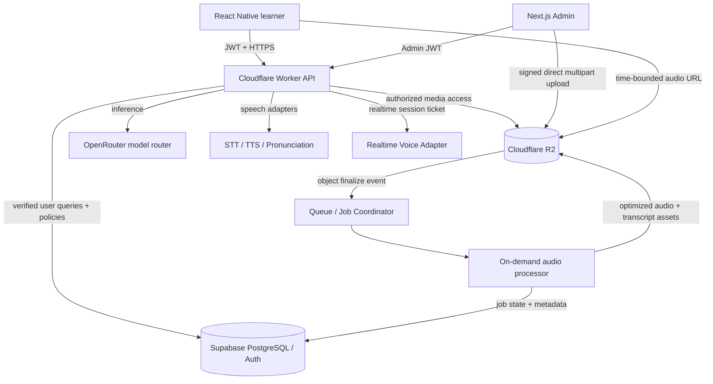

# MASTER BUILD SPECIFICATION — Conversation-First, AI-Native Language Learning App

**Document type:** Single-file, comprehensive product requirements document + engineering execution prompt for an autonomous coding agent  
**Version:** 1.1
**Date:** 2026-10-14  
**Status:** Authoritative full-product target; phased implementation permitted, feature removal not permitted  
**Working name:** `LangQuest`
**Business model:** **100% free to learners; accounts required to persist user progress; no subscriptions, credits, paywalls, ad requirements, trial periods, artificial daily limits, or user-facing AI-minute caps.**

> **PRIMARY DIRECTIVE TO IMPLEMENTING AGENT:** Build the complete product described here, as a cohesive working mobile application plus administrator console and supporting backend. Use phases and acceptance tests to manage the work, but do not misinterpret phases as permission to ship a permanently reduced MVP. Avoid mock backends, decorative nonfunctional buttons, fake scores, fake speech analysis, fake courses, broken media, and content that purports to be in a dialect but is actually Modern Standard Arabic or another variety. Integrate real providers when credentials exist; when credentials or licensed content are unavailable, implement tested adapter interfaces, explicit setup steps, and clear content/availability states rather than inventing successful integrations. Keep every stated language track in the catalog and furnish a real path to content coverage for each.

---

# 0. EXECUTIVE BRIEF / NON-NEGOTIABLES

## 0.1 Product mission

Create an exceptionally **fun, rapid, interactive, listening- and speaking-oriented** language-learning app that enables users to **have actual conversations with other people**. The app should feel like a compelling game and authentic social immersion, **not a grammar workbook**. Practical comprehension, intelligent phrase retrieval, natural pronunciation, cultural context, and spontaneous speech are the outputs. Grammar and conjugation are acquired through patterns and usage, with short **optional** explanations when useful. Lessons should start getting users to speak in the very first session; progress should be demonstrated through fresh, unrehearsed communicative tasks rather than tapping correct word tiles.

Inspirations to synthesize:

- **Duolingo:** fun micro-lessons, reward loops, progression, memorable characters, achievements, streaks (without punitive loss aversion), responsive UX.
- **Pimsleur:** listen → anticipate → speak *before* hearing the model answer → compare → retrieve again with graduated intervals, audio-only mode.
- **Rosetta Stone:** imagery and contextual association, less forced translation, comprehensible input.
- **AI conversational apps:** adaptive speaking partners, in-character role-play, interruption handling, context-aware responses and personalized corrections.
- **Audiobook / audio-course apps:** a full catalog and player for the founder's large MP3 library, synchronized text and optional AI follow-up exercises.

## 0.2 Firm product rules

1. **All product features and course tracks are free for every registered learner.** No premium flags, coins purchased with money, metered usage UI, minute allowances, billing integrations, subscription tables, or fabricated checkout pages.
2. **Accounts:** email/password and optional OAuth, secure authentication, profile, cloud sync, multi-device continuity, deletion/export, settings, progress.
3. **30 requested selectable learning tracks** (enumerated exactly in §2; includes Arabic varieties and Chinese script-specific entry).
4. **Course-specific language of instruction (`source_language`).** Detect initial preference on onboarding; every enrollment stores its own editable learning-from language. English is first production localization priority; **French is second and highest non-English priority**, then Spanish/Russian, then the other supported interface/source languages as content is validated.
5. **Speak-first:** guided and free-form AI voice conversations, listening, high-quality reference speech, repeated phrases, pronunciation evaluation and helpful visual feedback.
6. **Genuine conversational proficiency** over perfect grammar, literal phrase matching, arbitrary accent reduction, or mindless XP.
7. **OpenRouter is the preferred configurable LLM routing gateway**, not a hard-coded model. STT/TTS may use OpenRouter where tested; realtime full-duplex and phoneme-scoring adapters remain independent and replaceable.
8. **Own and manage large MP3 libraries:** bulk uploading, direct cloud transfer, metadata labeling, language/locale/speaker/chapter/lesson/description/course hierarchy, publisher workflow, player, offline audio, optional transcription/alignment, AI exercises.
9. **Cost-conscious scalability** without user-facing feature caps. Minimize static content and database cost; reuse generated content; route heavy work to async processing; monitor spend and prevent malicious abuse. Never silently degrade or revoke normal learner features as a commercial tiering tactic.
10. **Legally sourced material only.** No scraped copyrighted courses, unauthorized publication of purchased MP3s, unlicensed voice cloning, or misleading assertions that a public dataset is commercially redistributable.
11. Mobile-first, fast, polished, accessible, responsive, privacy-conscious, with language-aware RTL and script support.
12. All 30 entries should be implemented as genuine discoverable course tracks in the final app, with functional onboarding, instruction-language preference, audio/mission data handling and AI adapter configuration. Release readiness for individual dialect/language requires honest capability QA; never fill gaps with a different language while displaying the requested one.

## 0.3 Definition of 'free and unlimited'

Normal users may use all content and all enabled features without a paywall or product-imposed daily usage quota. This is a **commercial/product decision**, not a promise that external infrastructure costs zero, AI capacity is mathematically infinite, or abuse controls can never intervene. Enforce authentication, safe request validation, reasonable anti-bot throttles, spam defenses, concurrency/circuit breakers, provider-failure recovery and operator cost observability behind the scenes. Distinguish security protection from a monetization limit; don't build a credits economy. Escalate operator alerts when expense is atypical, prefer efficient fallbacks, and never promise a feature that underlying providers can't technically deliver.

## 0.4 Completion definition

A successful end-to-end app permits a real account to: select any offered course, select/change its instruction language, take guided lessons, hear correct spoken target-language prompts, record speech and obtain **genuine** feedback, conduct live AI character conversations, receive adaptive recall, earn game progress, play permitted audio lessons from the admin library, download them for offline playback, synchronize across devices, and delete their data. An authorized administrator can upload many gigabytes of audio, apply/edit batch labels, inspect licenses, manage courses/dialects, review/generated materials and AI configs, publish content, and inspect operational metrics. A feature counts as finished only when end-to-end tests pass.

---

# 1. PERSONAS, JOBS-TO-BE-DONE, AND EXPERIENCE

## 1.1 Learner personas

- Complete beginner: zero target-language vocabulary; needs visual comprehension, confidence, slow speech, short prompts, an easy first win.
- Returning learner: some conversational ability but slow recall; needs active retrieval, varied scenarios and honest diagnostics.
- Audio-first learner: walks, commutes, trains with screen off; needs hands-free Pimsleur-style prompting and background playback.
- Diaspora/heritage learner: may understand speech but hesitate to speak, or use a regional dialect not taught in conventional courses.
- Multilingual learner: may learn Arabic from French, Japanese from Spanish, or English from Russian, with separate preferences per enrollment.
- Advanced learner: wants spontaneous small talk, narration, argumentation, real-world accents, faster turn-taking, and less intrusive correction.

## 1.2 Experience principles

- **First-minute achievement:** make the learner hear, understand and successfully say a meaningful phrase almost immediately.
- **Comprehension scaffold:** listen with visual context, synonyms, replay, slow playback, optional translation, subtitles/scripts, selective highlights. Scaffolding fades over time.
- **Speech is the default action:** users frequently speak naturally, but accessibility and noisy-environment alternatives are provided.
- **No worksheet-first onboarding:** do not make users study grammar tables before conversations.
- **Short sessions:** 5–15 minutes; adjustable lesson duration; longer audio sessions and open conversations optional.
- **Stories matter:** recurring characters, relationship progression, surprises, believable consequences, regionally appropriate settings.
- **Mistakes are useful:** correct what blocks meaning, target one or two priority issues, avoid shaming an accent or constantly interrupting.
- **High production values:** expressive audio, pleasant clean visual design, tasteful animation, fast controls, consistent character art and voices.
- **Not a chatbot with a language-learning skin:** exercises must link to mastered skills, scenes, success conditions, generated variations and spaced-repetition scheduling.
- **Culturally authentic:** dialect-appropriate speech, etiquette, non-stereotyped people and locations; honor regional variants.

## 1.3 Primary mobile navigation

Five tabs: **Home**, **Missions**, **Audio**, **Speak**, **Progress**. Profile/settings from Home. Support tab-specific search; course switcher globally available. Each screen must show the active target course and the saved `source_language` for that course, plus an edit affordance.

### Home

- Welcome/back-to-learning, current course, daily adaptive suggested mission, current storyline, listening progress, due-for-recall exercises, optional streak and achievements, resume action.
- Quick change of target course; instruction language visible; no mandatory premium upsell.
- Daily feedback uses real learner data; do not show fictitious progress.

### Courses / catalog

- Search/filter all 30 requested tracks by region, script, level, availability, and sound sample.
- Clearly distinguish target spoken variety, locale, transliteration, writing system, and course instruction language.
- Per-course enrollment wizard: default source language from account, editable before enrolling, then editable later without losing progress.
- Multiple parallel enrollments supported; one active at a time; remove/archive enrollment with confirmation; preserve progress unless user requests deletion.

### Missions

- Map/story or ordered mission cards, skill outcomes, durations, and required speaking/listening actions.
- Immersive backgrounds, useful audio hints, context images, replay, slower speech, optional transcripts and translations.
- Branching speech missions with adaptive difficulty and actual conversational success criteria.
- Guided lesson and role-play modes, optional audio-only view.

### Audio

- Catalog of authored audio courses, uploaded MP3 courses, chapters, tracks, bookmarks and continue-listening.
- Audible/original course player with playback speed, skip ±10/15 seconds, seek, chapter navigation, sleep timer, background/lock-screen controls, offline download, listening-history sync.
- Original audio is always playable unaltered (where licensed). Optional enhanced experience: transcripts, translated transcript, karaoke highlighting, A/B loop, vocabulary extraction, speak-after-listen and AI mission based on the recording.
- Search by both learning and instructional language, regional accent, speaker, chapter and subject.

### Speak

- Short pronunciation drills, shadowing and phrase repeats; guided dialogues; free-form AI conversational partner; quick impromptu speaking challenge.
- Character selection by persona/region/voice where suitable. Live feedback after conversation; dedicated pronunciation mode gets more detailed feedback.
- Hands-free mode, push-to-talk fallback, audio device permissions and recovery.

### Progress

- Can-do mastery by practical skill; listening comprehension, independent spoken response, intelligibility, fluency and phrase retention.
- Due-for-recall calendar, expression history, areas needing practice, mission successes, speaking-time history as a secondary metric, achievements.
- No fabricated fluency score; show evidence, uncertainty and next actions.

### Account + Settings

- Account auth, recovery, notification controls, audio quality / downloads, text scaling, contrast, accessibility, speech preferences, transliteration options, source-language preference default, course-by-course overrides, transcript storage/privacy, export/delete, help and reporting.

---

# 2. REQUIRED LANGUAGE / DIALECT CATALOG

**Important:** There are **30 course entries**, not necessarily 30 distinct spoken languages. The database must separately model the display entry (course track), its spoken variety, BCP-47 locale where applicable, scripts and orthography. An instructional language is not the same as the target spoken language.

| # | Course entry (preserve user-facing name) | Internal target/locale guidance | Script and special requirements |
|---|---|---|---|
| 01 | Arabic (Eastern) | `ar-levant` internal variety ID; initially Levantine/Eastern Arabic umbrella, regional subvarieties Syrian/Lebanese/Palestinian/Jordanian | Arabic RTL; regional lexical/phonetic variation. **'Eastern' is not a precise single dialect; set documented assumption and make regional selector editable rather than claiming one uniform accent.** |
| 02 | Arabic (Moroccan) | `ary`, Moroccan Darija | Arabic RTL and user-selectable Latin/Darija Arabizi; French code-switch; native validation mandatory |
| 03 | Arabic (Egyptian) | `arz` / `ar-EG` | Arabic RTL; Egyptian colloquial, not MSA |
| 04 | Arabic (Modern Standard) | `arb` / `ar` with MSA variety | Arabic RTL; formal modern register; not a substitute for other colloquial courses |
| 05 | Chinese (Cantonese) | `yue` / `zh-HK` | Traditional characters by default, optional romanization (Jyutping), tone-rich pronunciation, Cantonese != Mandarin |
| 06 | Chinese (Mandarin) | `cmn` / `zh-CN` default; allow regional voice/script variants | Simplified by default, Traditional option where supported, Pinyin with tone marks |
| 07 | Chinese (Simplified) | *Separate selectable learning track with Mandarin speech and Simplified script priority*, linked to Mandarin underlying language assets | **Simplified is a writing system, not a spoken language.** Preserve requested catalog option, share compatible Mandarin language/voice content; distinguish focus on reading/writing Simplified from the general Mandarin track |
| 08 | English | `en` (US default, GB selectable) | Explicit **English taught FROM French, Spanish, Russian, etc.**; not English-only teaching |
| 09 | Danish | `da-DK` | Latin |
| 10 | French | `fr-FR` default, `fr-CA` option | Regional pronunciation |
| 11 | German | `de-DE` | Latin |
| 12 | Greek | `el-GR` | Greek script |
| 13 | Haitian Creole | `ht-HT` | Haitian orthography; do not replace with French |
| 14 | Hebrew | `he-IL` | Hebrew RTL; optional transliteration/vowel points where pedagogically useful |
| 15 | Hindi | `hi-IN` | Devanagari; optional romanization |
| 16 | Italian | `it-IT` | Latin |
| 17 | Japanese | `ja-JP` | Kana/kanji, optional romaji and furigana |
| 18 | Korean | `ko-KR` | Hangul; optional Revised Romanization |
| 19 | Portuguese (Brazilian) | `pt-BR` | Brazilian voice/diction/lexicon |
| 20 | Portuguese (European) | `pt-PT` | European Portuguese speech and lexicon |
| 21 | Romanian | `ro-RO` | Latin |
| 22 | Russian | `ru-RU` | Cyrillic; optional transliteration; stress handling |
| 23 | Spanish (Latin American) | `es-419` umbrella; regional voice selections e.g. `es-MX` | Neutral pan-Latin American base with regional variation markers; not one universal accent |
| 24 | Spanish (Spain-Castilian) | `es-ES` | Castilian voice and lexical preferences; distinguish Latin American |
| 25 | Swahili | `sw` (Tanzanian/Kenyan variety selector) | Latin; Kenyan/Tanzanian usage distinctions |
| 26 | Kinyarwanda | `rw-RW` | Native-validated speech; limited automated scoring support |
| 27 | Swedish | `sv-SE` | Latin |
| 28 | Lingala | `ln` (DRC/Congo regional option) | Native-validated speech; regional features; limited automated scoring support |
| 29 | Ukrainian | `uk-UA` | Cyrillic; optional transliteration |
| 30 | Vietnamese | `vi-VN` | Tone-rich Vietnamese; northern/southern voice variants |

### 2.1 Source / instruction-language system (critical)

The user learns **target language `T` from source language `S`**. These may differ for each enrolled course. Example:

- Account default preferred learning-from language = **French**.
- Enrollment A = *Arabic (Moroccan)* **from French**.
- Enrollment B = *Japanese* **from English**.
- Enrollment C = *English* **from Russian**.
- Enrollment D = *Portuguese (Brazilian)* **from Spanish**.

On registration: choose preferred app UI language (default device-supported locale, with override), default **instruction language** (prefer English or French, independent of UI), and optionally proficiency/preferences. When adding ANY course, prefill the enrollment instruction language from account preference, then expose a selector containing the catalog's supported languages. Persist an **explicit `source_language_code` on every `user_course_enrollments` row**, even if identical to the profile default. A later profile-language update **does not silently rewrite** existing course enrollments. Each enrollment exposes an edit control and can be changed whenever requested without clearing progress, bookmarks, or skill mastery. Trigger new teaching overlays and audio where available; invalidate stale language-specific caches. User can temporarily show translations in a third language without changing the enrollment.

**Production priority for teaching content and full app translations:**

1. English as source for all 30 tracks.
2. **French as source for all 30 tracks** — firm top priority immediately after English.
3. Spanish and Russian as source for all 30 tracks.
4. Expand to other catalog languages as source languages. The system must be language-pair agnostic, never hard-code `en` source.
5. For reverse-direction English target courses, French → English, Spanish → English and Russian → English are explicit acceptance-test paths.

For languages with insufficient high-quality source translations/audio, display clear editorial status within the enrollment and route creation for native review. **Do not silently fall back to English while claiming to teach from French.** If a fallback is necessary, show the learner and let them opt into it. Final target is complete validated instruction-language coverage.

### 2.2 N-to-M translation scalability

Do **not** hand-create 30 × 30 independent courses. Create reusable **language-independent communicative intents and missions** (e.g. `request_a_drink`), with target-language utterances, target-script/transliteration assets, source-language explanatory overlays, source-language instructions, and localized UI labels. Link equivalent ideas by semantic concept IDs, not merely text equality. Build a translation/localization quality workflow so dynamic pairs scale as combinations of reusable layers, not duplicated curricula. Preserve genuine differences: forms of politeness, idioms, cultural routines and dialect-specific responses must *not* be generated as naive word-for-word translations.

### 2.3 Regional and script QA

- A dialect track must have authentic pronunciation examples and validated conversational prompts; an Arabic-script renderer isn't a dialect implementation.
- Tone errors in Mandarin, Cantonese and Vietnamese require tone-aware coaching where supported; do not assert unavailable phoneme-level precision.
- Handling RTL: correct bidirectional text, punctuation, mixed Arabic/Latin segments, selection, numerals, transliteration toggle and screen-reader support.
- Content scripts are selected independently of source language; display target writing with source-language translation optionally.
- Teach culturally natural code-switching where used (e.g. Darija/French); not as a blanket excuse for incorrect translations.
- Version and record reviewer identity/region for every language asset, and reevaluate content when dialect normalization changes.

---

# 3. FULL LEARNING EXPERIENCE & PEDAGOGY

## 3.1 One connected learn → speak → remember loop

1. **Context:** show a useful scene and situation (visual / short clip / description); learner hears comprehensible speech.
2. **Understand:** expose optional image cues, translations, target text, slow playback and repeated listening.
3. **Anticipate:** prompt a meaningful spoken response **before** revealing a correct model reply (Pimsleur-style active recall).
4. **Pronounce:** compare learner attempt with authentic sample; show specific, not excessive, sound guidance.
5. **Communicate:** apply the expression in a guided role-play with branching, semi-open response acceptance.
6. **Improvise:** adapt to a fresh scenario and produce an unrehearsed response (true transfer assessment).
7. **Retrieve again:** reintroduce fragile skills in new conversations, short drills and later sessions using spaced recall.
8. **Prove mastery:** progress requires meaningfully handling an interaction with decreasing assistance, not completing a fixed number of taps.

## 3.2 Lesson types (all required)

- Listen & identify meaningful intent with visual options.
- Listen, pause, **anticipate and speak**, reveal, compare, repeat.
- Shadowing with waveform/short repeat or A/B loop and optional delayed playback.
- Guided role-play: bounded objective with multiple semantically valid answers.
- Free conversation: open topic, level-aware AI partner, interesting follow-up questions.
- Listening comprehension: real voices at normal / slow speed and different accents.
- Mission story: branching characters and scene stakes, persistent character relationships.
- Pronunciation micro-drill: difficult consonants, tones, vowel distinctions, syllable stress/rhythm where supported.
- Situational task: restaurant, introductions, meeting people, jobs, directions, shopping, emergencies, travel, family, plans, daily life and debates.
- Audio-only/Pimsleur mode: pauses for answers, background audio, optional voice response while walking/commuting, robust safety interactions.
- Adaptive 1–3 minute reviews, interleaved with new lessons; no compulsory grammar unit.
- Audio-course-linked lesson: listen to an MP3 chapter → select phrases → practise → role-play new variant.
- Optional writing/reading support for scripts/orthographies, without turning the core into conjugation exercises.

## 3.3 Standard ~8-minute mission template

- ~1 min situational listening/context.
- ~1.5 min modeled expressions with visual anchor, slow replay and speaking.
- ~1.5 min anticipation/active retrieval.
- ~3 min interactive character conversation with mission outcome.
- ~1 min targeted feedback, retry and future recall assignment.

Actual duration is configurable; challenge duration depends on learner pace and supports pause/resume. The AI must vary situations and natural phrasings rather than always emitting the same deterministic script.

## 3.4 Pedagogical scoring and mastery

Define reusable communicative skill units, e.g. `greet_politely`, `ask_price`, `request_item`, `repair_misunderstanding`, `respond_to_unexpected_question`, `narrate_past_experience`. Store evidence dimensions separately:

- Listening comprehension.
- Independent spoken production / reduced need for hints.
- Semantic communication success; appropriate politeness and register.
- Intelligibility, optionally specialized pronunciation sub-scores.
- Fluency (hesitation, timing) with appropriate uncertainty.
- Retention after delays and transfer to unseen situations.

Track **observations** instead of inventing objective scores. Schema: skill, observation type, scenario ID, autonomy/hints, utterance confidence, model scorer version, timestamp and uncertainty. Use a transparent state such as `not_attempted / emerging / practiced / independent / durable`; weighted numeric mastery may be internal. Do not interpret a transcript matching the reference as reliable evidence of good pronunciation. Use optional human evaluation periodically to calibrate AI assessments. Align high-level proficiency labels with CEFR can-do descriptors where appropriate, without claiming official CEFR certification.

## 3.5 Spaced repetition and adaptive curriculum

- Implement a proven scheduling approach (e.g. parameterized FSRS-like scheduling or evidence-weighted interval schedule) for expressions **and communicative skills**, not only isolated words.
- Record response quality, hints required, effort/replay, actual interval and next due; keep algorithm pluggable and testable.
- Reintroduce target skill within meaningful context, preferably different characters/situations, not identical flashcard recall.
- Correct repeated misunderstandings, low-confidence speaking, code-switch difficulty and vowel/tone problems through a targeted review path.
- Avoid excessive reviews that crowd out novel content; diversify difficulty and challenges.
- Progress can branch and adapt; give the user optional manual lesson browsing and practice selection.

## 3.6 Pronunciation coach — feature contract

- Listen to an authentic high-quality sample; tap/hold mic and repeat; visualize recording states (not fake accuracy).
- Support intelligibility feedback, word-level alignment, where accurate phoneme/tonal/stress feedback is available, rhythm, natural phrasing, example correction and replay in slow/normal modes.
- When supported by actual scorer: highlight a relevant segment and show actionable mouth/stress/tone guidance; allow rerecord and measure improvement.
- Dedicated practice can be detailed; normal conversations should not constantly stop to correct every mistake. Give 1–2 meaningful corrections after mission.
- Prefer reliable target-locale pronunciation. Evaluate whether dedicated services support requested language/accent. If not, provide honest lower-fidelity assistance (listen/repeat/meaning comprehension) and **do not fabricate 87/100 phoneme scores**.
- Respect dialect and learner accents. Primary aim: understood naturally; native-like accent refinement optional.
- Multi-speaker audio and code-switch assessments need explicit fallback logic; do not use unsupported single-language scorers indiscriminately.
- Privacy: get microphone permission, make storage of recording optional where possible; avoid default long-term storage of speech and allow deletion/export.

## 3.7 AI conversational characters and storylines

- Persistent named characters with role, region, dialect, personality, voice, natural speech speed and learner relationship memory.
- Missions have controllable objectives, scene facts, tools/hints, possible consequences and branching paths.
- Conversations react to unexpected answers, requests for clarification, hesitations, interruptions and mistakes; avoid scripted dead ends.
- 'Ask slower', 'repeat', 'translate', 'give an example', 'what does that mean?', 'hint' and 'skip for now' are available, including voice commands if reliable.
- Multi-turn assessment must identify objectives completed and language skills exercised, not just count turns.
- Persist **safe, concise learning/story summaries** after chats; long raw transcripts need opt-in and retention controls.
- Personalize scenarios to learner interests only with appropriate consent. Keep characters supportive rather than manipulative or emotionally dependency-forming.
- Optional character voice/dialect selection and relationship-based mini-stories; story progression tied to can-do proficiency.
- Allow a text-only fallback for accessibility/noisy environments; speaking remains the principal experience.

## 3.8 Gamification system

- XP for meaningful effort and task completion, achievements for can-do skills, optional daily streaks, optional levels/regions/cities, narrative unlocks, character arcs, thematic chapters, friendly celebrations, optional social challenge/leaderboard with opt-out/privacy.
- XP validated server-side; no XP as proof of proficiency; learning mastery recorded separately.
- No shaming missed days or manipulative streak punishments; configurable notifications.
- Missions can visually unlock cities/scenes but the learner can still reach all free content via sensible browsing.
- Offline progress synchronized idempotently; achievements should not be farmable by submitting the same response repeatedly.

# 4. ARCHITECTURE: LOW-COST, SCALABLE, MODULAR

## 4.1 Chosen production stack

| Layer | Technology | Mandate |
|---|---|---|
| Mobile | React Native + Expo + TypeScript | iOS and Android, polished audio/background behavior, local/offline data, microphone and realtime voice |
| Admin web | Next.js + TypeScript | Private administrator CMS for many GB of audio, courses, content generation, review and publishing |
| Identity and database | Supabase Auth + PostgreSQL | Profiles, per-course enrollment source languages, curricula, content metadata, learning mastery, rights, jobs; RLS |
| Bulk audio/object media | Cloudflare R2 Standard | Original uploaded MP3/WAV/M4A files, optimized renditions, thumbnails, downloadable course packages; private bucket where appropriate |
| Lightweight backend edge | Cloudflare Workers in TypeScript | Authenticated app API, signed media access, model routing, request validation, cache/version dispatch, concurrency controls |
| Async processing | Cloudflare Queues + appropriate dedicated on-demand processing workers for FFmpeg/audio-heavy tasks | Robust retries for transcription, waveform, transcoding, metadata inference, alignments, indexing |
| AI text/conversation intelligence | **OpenRouter** API, configurable by task & locale | Dialogue reasoning, level adaptation, content creation, semantic assessment, corrective feedback, summaries |
| STT/TTS | OpenRouter speech APIs **when compatible**, pluggable specialist fallback | Transcriptions and dialect-appropriate synthetic speech |
| Low-latency realtime voice | Pluggable duplex session provider or streaming STT→OpenRouter LLM→TTS pipeline | Natural turn taking, interruptions/barge-in, high-quality audio; prioritize measured latency and dialect quality |
| Pronunciation assessment | Specialized provider adapter (e.g. Azure Pronunciation Assessment for supported locales) + reference-audio/manual alternatives | Trustworthy, differentiated assessment across locales; never fake precision |
| Mobile audio runtime | Expo-compatible native audio SDK; use Expo Audio if feature coverage passes QA | Foreground/background, lock screen, downloads, seek, rate, interruptions, Bluetooth |
| Analytics | Privacy-conscious event telemetry (e.g. PostHog, or simpler self-managed aggregation) | Learning outcomes, UX funnel, performance and costs; never ad targeting by default |
| Error/observability | Sentry or equivalent + structured logs | Crash reporting, model latency, queue failures, storage and API errors |
| i18n | ICU-compatible translation message framework | English-first and French-second localization; dynamic target/source languages; RTL |
| Infrastructure as Code / tooling | Cloudflare Wrangler, Supabase migrations CLI, CI/CD | Versioned reproducible deployments, dev/staging/prod environment isolation |

**Avoid** Kubernetes, premature microservices, permanent GPU nodes, per-user isolated databases, direct streaming through the Next.js app, or building an original LLM/ASR/TTS model before provider evaluations justify it. Keep swappable interfaces across vendors. Do not add RevenueCat, Stripe, subscriptions or payment entities while the product is entirely free.

## 4.2 Proposed repo tree

```text
language-app/
  apps/
    mobile/                       # Expo React Native app
      app/                        # typed routes
      src/screens/
      src/components/
      src/features/{auth,courses,missions,listen,speak,progress,account}/
      src/audio/                  # recording, playback, offline download, background controls
      src/i18n/
      src/state/
    admin/                        # Next.js private CMS
      app/{login,dashboard,library,courses,lessons,ai,rights,review,jobs,analytics}/
      src/features/{upload,bulk-edit,review,transcripts,models}/
    api/                          # Cloudflare Workers HTTP entry
      src/routes/
      src/middleware/
    jobs/                         # queue consumers + on-demand CPU/audio processing
  packages/
    contracts/                    # Zod schemas / TS types for API and storage messages
    db/                           # typed DB queries, RLS tests, migrations
    curriculum/                   # skill/mission definitions, prereqs, spaced repetition
    ai/                           # OpenRouter, dialogue, STT, TTS, realtime, pronunciation adapters
    locales/                      # UI translations, scripts, language configs
    ui/                           # shared design system
    media/                        # audio metadata, segmenting, content hashes, licenses
    telemetry/                    # app cost and outcomes events
  scripts/
    import-tatoeba/
    import-corpora/
    bulk-audio-scan/
    license-report/
    seed-languages/
    validate-course-coverage/
  supabase/migrations/
  infra/cloudflare/
  tests/{unit,integration,e2e,security,audio,locales,load}/
  docs/{decisions,provider-matrix,content-rights,runbooks}/
  README.md
  .env.example
```

Use one `pnpm` workspace or equivalent with strongly typed contracts. Mobile works independently from admin and isn't forced to download full course catalogs at startup. Architectural decisions live in short ADR files with tested tradeoffs.

## 4.3 Request/control flow



Keys live server-side and are scoped appropriately. App-to-provider direct connection is allowed **only** via short-lived, purpose-limited session tokens issued by the backend if a realtime provider requires them. Do not ship OpenRouter master keys, R2 API secrets, Supabase service-role keys or any unrestricted credential in the mobile bundle.

## 4.4 Media delivery strategy

- Upload original masters and generate optimized voice-friendly output (e.g. AAC or Opus at audited bitrate), preserving source recordings; avoid converting if no audible/size benefit.
- R2 object keys use generated IDs and content hashes, not user-controlled filenames. DB owns file labels; file title changes do not move objects.
- Private R2 storage; the media API authorizes access to a particular file using the user's account and content publication/rights state. Serve range-capable short-lived signed GET URLs or authenticated Worker proxy where practical. Account for expiry during long playback and downloads.
- Support HTTP byte-range requests, seek, resume, ETag, content-length, cache-control and correct content types.
- Offline downloaded licensed course media stored with a durable local index, checksums, download progress, retry, safe cleanup and optional optional device encryption. **Do not claim unbreakable DRM.** Respect asset distribution rights.
- Make a public domain/cache only for explicitly approved public assets (e.g. images, licensed reusable voice clips), never accidentally publish private licensed files via a public R2 custom domain.
- Generate compact, versioned **course manifests** that map course/chapters/tracks, descriptors, URLs obtained lazily, transcript IDs, locale, version and caching checksums. Edge-cache non-personal manifests rather than querying Postgres every render.
- Do not assume the lack of R2 bandwidth fees means 'zero total infrastructure cost': R2 operations, processing, DB, AI, auth, cache and monitoring still cost money.

## 4.5 Offline-first behavior

- Local SQLite (or equivalent) for downloaded course metadata, bookmarks, listen positions, SRS due queue, completed structured exercises and unsent events.
- Record immutable client event IDs and monotonic/revision metadata; dedupe server ingestion on replay; account for clock skew.
- Offline: stored media, downloaded lesson packs, pre-generated listening prompts, deterministic SRS and local progress work. Dynamic AI/free conversation requires connectivity unless an explicitly supported local model is installed and verified.
- Sync safely after reconnect; never double-award XP or delete progress due to event replay.
- Auto-download only with user opt-in; Wi-Fi/cellular controls and storage management.

## 4.6 Scale and reliability

- Traffic classes: static catalogs, R2 media, lightweight progress updates, live AI/audio; separate monitoring and performance targets.
- 100k monthly active accounts must not imply 100k concurrent AI voice sessions. Measure concurrent sessions and apply autoscaling, queue backpressure and security defense, not misleading user-facing paid quotas.
- Batch idempotent progress writes, cache heavily shared data, index high-frequency reads, paginate long history, compress JSON, avoid fetching transcripts/audio unnecessarily.
- Use provider fallback with typed capability checks; missing language/voice support must not be patched by silently switching dialect.
- Recover mid-lesson from network interruptions; preserve last interaction and retry short operations safely.
- Concurrency/disaster tests: multiple devices, upload failures, midstream playback URL expiry, revoked media, server restarts, provider outages, overlong transcription files, duplicate jobs.

---

# 5. DATABASE — DETAILED MODEL

Use PostgreSQL with UUID identifiers, timestamptz, appropriate unique/index constraints, tenant-safe row-level security, migrations, and content revisions. Store raw file bytes in R2, not Postgres. The following is a minimum **complete conceptual schema**; implement through migrations and typed repositories.

## 5.1 Identity and configuration

- `profiles`: `user_id PK references auth.users`, `display_name`, `ui_locale`, `default_source_language_code`, `time_zone`, `created_at`, `updated_at`, `privacy_options`, `accessibility_options`.
- `account_settings`: notification preferences, audio speed, preferred input/output device, default hint behavior, script/transliteration preferences, offline download settings, retention settings.
- `languages`: canonical language/family (`id`, ISO-like code, English/native display names, default script, RTL flag, pluralization metadata).
- `language_varieties`: `id`, `language_id`, dialect name, BCP47 locale mapping if available, regional notes, code-switch norms, alternative names, localized voice settings.
- `writing_systems`: script metadata (Arab, Latn, Hans, Hant, Cyrl, Grek, Hebr, Deva, Jpan, Kore etc.) and renderer rules.
- `course_tracks`: 30 explicitly requested selectable entries; `id`, user-facing name, primary target variety, scripts, default voices, teaching focus, publication state; Chinese Simplified track linked to Mandarin shared targets.
- `user_course_enrollments`: `id`, `user_id`, `course_track_id`, **`source_language_code` NOT NULL**, `preferred_target_variant_id`, `script_mode`, `added_at`, `last_opened_at`, `status`, `active_mission_id`, `preferred_learning_speed`; unique appropriate `(user_id, course_track_id)` or support multiple enrollments with distinct source language if intentional. **Changing source language must not reset mastery.**
- `course_source_localizations`: source language, course track, coverage metrics (mission instructions, explanations, UI, subtitles, native-reviewed flag). Drives honest availability status.

## 5.2 Curriculum core

- `skills`: semantic learning outcomes (`skill_key`, descriptor, difficulty, target family, CEFR-like can-do alignment, prerequisites).
- `skill_variants`: locale/dialect-specific realization and reviewer state.
- `communicative_intents`: language-independent concept IDs, response constraints, social meaning, polarity/politeness.
- `expressions`: `id`, intent ID, target variety, canonical written form, register, difficulty, scenario tags, script/phonetic annotations, reviewed flag, content rights ID.
- `expression_forms`: localized script/transliteration/orthography forms and word alignment, tone markers, optional IPA.
- `expression_translations`: expression ID, **source language**, natural meaning and context note, translation QA state, not literal text only.
- `expression_audio`: expression ID, voice ID, asset ID, speech rate, accent/quality/review flags.
- `lesson_courses`: learning content collections, language track, cover, description, editor state, order, rights.
- `chapters`: course ID, title translations, description translations, index, scene and region.
- `missions`: chapter ID or cross-course template, mission type, goals, target variant, recommended minutes, published revision, prerequisite skills, difficulty, narrative segment and scoring rubric.
- `mission_localizations`: mission ID, **source language**, source-language instructions/hints/help and QA status.
- `mission_steps`: phase/type, prompt assets, target example IDs, success conditions, hint scaffold, valid semantic responses, branching metadata, media.
- `mission_graph_edges`: prerequisite/next mission, optional branch, reward and character memory change.
- `dialogue_scenarios`: scene, role, character, difficulty boundaries, expected intents, interruption policy, safety and topic rules.
- `dialogue_variants`: human-reviewed sample dialogues and alternatives, accents, localized support.
- `characters`: fictional identity, personality, home region/variety, consistent voice, storyline facts, look/avatar, safety rules, relationships.
- `story_arcs`: character/region narratives with milestone conditions and learner memory schema.
- `media_assets`: source object ID, owner, checksum, MIME, size, duration, channels, bitrate, source/derived relationship, public/private, rights, disposition.
- `content_rights`: canonical origin URL, authors/speakers, permission grant, license version, commercial redistribution rights, attribution required, alterations permitted, voice rights, expiration/revocation, evidence reference and reviewer sign-off.
- `content_revisions` + `publication_events`: version, edits, reviewer, status, timestamps, rollback.

## 5.3 Audio-library and CMS schema

- `audio_course_collections`: display course + optional parent learning language, **instruction language**, region, instructor, description, license, publish status.
- `audio_chapters`: collection ID, localized title/summary, order, cover.
- `audio_lessons`: chapter ID, localized title/description, order, level, speaker(s), both language fields, tags, status, transcript status, listen-length.
- `audio_lesson_assets`: lesson ID, asset ID, type (`master`, `mobile_encoded`, `review`, `slow`, `clip`, `cover`), order.
- `speakers`: pseudonymous or consented name, dialect/region, legal consent/rights record, optional voice description; never infer speaker identity from dataset audio.
- `lesson_speakers`: multiple speakers per lesson with role and voice segments where known.
- `transcripts`: lesson ID, source/target/mixed language, transcription revision, coverage, QA status, transcript access rights.
- `transcript_segments`: start/end in milliseconds, text, speaker label if known, target language/dialect, script variant, confidence, translated content relationship.
- `transcript_translations`: segment ID, source/UI language, quality flags, meaning.
- `transcript_word_alignments`: optional precise word timestamps and links to expressions.
- `lesson_tags`, `lesson_topics`, `bookmarks`, `user_audio_progress`, `user_download_manifests`.
- `uploads`: asset draft, upload ID, multipart session metadata, original filename, user, client checksum, finalize status, idempotency key.
- `processing_jobs`: type, parent asset, state (`pending/running/succeeded/failed/review_needed`), retries, progress, provider, cost estimate/actual, failure code, output asset IDs.
- `asset_provenance_events`: audit history of source license and processing transformations.

## 5.4 AI, evaluations, personalization and tracking

- `ai_model_profiles`: task type, target variety, preferred model/voice/STT, fallback list, capabilities, budgets, provider, enabled flag, version, benchmark status. Do **not** persist secrets here in plaintext.
- `ai_model_benchmarks`: scored naturalness/intelligibility/dialect adherence/latency/cost, data sample set, evaluator version, reviewer.
- `ai_requests`: user id (where safe), task, selected model/provider, latency, token/audio seconds, estimated cost, success/error, privacy-preserving logs and trace ID.
- `conversation_sessions`: enrollment ID, mission ID, character ID, dialect, turn count, start/end, summary, learner privacy preference, rubric outcomes and revision.
- `conversation_turns` (optional consent/retention): no default long-term raw audio; sanitized text or hashes where necessary; timestamps, goals, hints, confidence.
- `character_relationship_memory`: user + character with concise story summary and durable preferences where consented.
- `user_skill_mastery`: enrollment, skill, mastery state, last practiced/due date, evidence count, uncertainty.
- `user_expression_reviews`: enrollment, expression, repetition schedule parameters, result, hint count, next due.
- `learning_observations`: semantic evaluation, listening outcome, target, speaker/ASR version, pronunciation confidence and feedback evidence.
- `mission_attempts`, `mission_progress`, `user_achievements`, `streak_activity`, `xp_ledger` (append-only/idempotent), `daily_learning_metrics`.
- `device_sync_events`: client UUID, user, payload type/revision, conflict resolution, applied timestamp, unique idempotency key.
- `notification_settings` + `notification_deliveries`, `feedback_reports`, `moderation_incidents`, `audit_logs`.

## 5.5 RLS and invariants

- Every user-owned row keyed by `user_id` is readable/writable only by owner or narrowly authorized admin functions. All exposed Postgres tables have reviewed RLS, with automated negative tests.
- Only admin/editor roles may create/publish/delete shared courses, modify global models or grant rights. Separate roles: `super_admin`, `admin`, `content_editor`, `language_reviewer`, `support_readonly`.
- Admin actions require server-validated role claims and are audit logged; hide controls is **not** authorization.
- Never allow raw rights/license records or files to be forged by a learner. User-contributed material has pending review and consent.
- `source_language_code` is mandatory for each enrollment. Retain it on resumption, source UI change, device reinstallation or course switch.
- Deleting a user cascades or anonymizes their personal information including recordings, summaries and derived user-specific content according to disclosed policy; publication/audit assets have appropriate legal retention policies.

---

# 6. EXTERNAL API / EVENT CONTRACTS

Define all request/response shapes in shared schemas, generated TS types, error codes, and JSON validation. API examples are **contracts**, not claims that endpoints already exist.

## 6.1 Learner account and catalog

```text
POST   /v1/auth/session/refresh                (via Supabase Auth where appropriate)
GET    /v1/me
PATCH  /v1/me/settings
GET    /v1/languages                          # metadata + target tracks
GET    /v1/courses?source=fr&target=ary
GET    /v1/courses/:trackId/coverage?source=fr
POST   /v1/me/enrollments                     # trackId, sourceLanguageCode
GET    /v1/me/enrollments
PATCH  /v1/me/enrollments/:id                 # sourceLanguageCode, scriptMode, dialect, etc.
GET    /v1/courses/:trackId/manifest?source=fr&version=...
GET    /v1/missions/:id?source=fr
POST   /v1/missions/:id/attempts
POST   /v1/missions/:id/evaluate
GET    /v1/me/reviews/due?enrollmentId=...
POST   /v1/me/progress/sync                   # idempotent batch events
GET    /v1/me/skills?enrollmentId=...
GET    /v1/me/progress
```

## 6.2 Speaking and AI

```text
POST   /v1/ai/conversation/session            # scoped authenticated session config/token
POST   /v1/ai/conversation/:id/turn            # text/audio reference + short state
POST   /v1/ai/conversation/:id/end             # objective outcomes, summaries, scheduling
POST   /v1/speech/transcribe                   # target variety + recording or upload reference
POST   /v1/speech/pronunciation-assess         # reference expression, locale, asset
POST   /v1/speech/synthesize                   # target variety, approved text, voice
GET    /v1/ai/model-capabilities?trackId=...
```

## 6.3 Audio library

```text
GET    /v1/audio/collections?language=ary&instructionLanguage=fr
GET    /v1/audio/collections/:id/chapters
GET    /v1/audio/lessons/:id
POST   /v1/audio/assets/:id/playback-url       # authorized private time-limited URL
GET    /v1/audio/lessons/:id/transcript?language=fr
PUT    /v1/me/audio-progress/:lessonId
POST   /v1/me/audio-bookmarks
GET    /v1/me/audio-download-pack/:lessonId
```

## 6.4 Administrator

```text
POST   /v1/admin/uploads/initiate             # signed multipart upload
POST   /v1/admin/uploads/:id/parts/sign
POST   /v1/admin/uploads/:id/complete          # checksum/size verification
POST   /v1/admin/uploads/:id/abort
POST   /v1/admin/library/import-r2-prefix      # reconcile bulk rclone uploads
POST   /v1/admin/library/import-manifest       # CSV or JSON labels
POST   /v1/admin/assets/bulk-label             # language, speaker, chapter, lesson, tags, etc.
GET    /v1/admin/assets?status=...&q=...
PATCH  /v1/admin/audio/lessons/:id
POST   /v1/admin/assets/:id/process            # transcribe/transcode/align etc.
GET    /v1/admin/processing-jobs/:id
POST   /v1/admin/content/generate              # content factory draft jobs
POST   /v1/admin/content/:id/request-review
POST   /v1/admin/content/:id/publish
POST   /v1/admin/content/:id/unpublish
GET    /v1/admin/licenses/attributions
GET    /v1/admin/models
PUT    /v1/admin/models/:task/config
POST   /v1/admin/models/:task/benchmark
GET    /v1/admin/analytics/{quality,cost,usage,errors}
```

Server emits structured domain events: `upload.finalized`, `asset.verified`, `transcode.requested`, `transcript.ready`, `translation.review_requested`, `lesson.published`, `manifest.invalidated`, `conversation.finished`, `skill.observed`, `review.due`. Use at-least-once event delivery with idempotent handlers.

## 6.5 API examples

Per-course enrollment:

```json
{
  "courseTrackId": "arabic-moroccan",
  "sourceLanguageCode": "fr",
  "targetVarietyId": "ary",
  "scriptMode": "both"
}
```

Speech evaluation result (do not report ungrounded scores):

```json
{
  "assessmentId": "uuid",
  "targetVarietyId": "ary",
  "semanticIntentMatched": true,
  "meaningConfidence": 0.88,
  "intelligibility": "understood",
  "pronunciation": {
    "assessmentMode": "human-calibrated-reference-comparison",
    "numericScore": null,
    "confidence": "limited",
    "feedback": ["The meaning came across. Listen to the model's rhythm and retry."]
  },
  "shouldAdvanceConversation": true
}
```

---

# 7. AUDIO LIBRARY + ADMINISTRATOR CMS — FULL REQUIREMENTS

## 7.1 Admin dashboard IA

Required sections: Dashboard, Uploads, Library, Collections/Courses, Chapters, Lessons, Speakers, Languages/Locales, Transcripts, Rights & Licensing, Content Factory, AI Models, Quality Review, Job Queue, Publishing, Analytics, Users/Roles, Settings and Audit Log. Access is restricted by roles.

## 7.2 Bulk uploads of many gigabytes

- Drag/drop individual files and nested folders; select thousands of files without freezing browser UI.
- Support MP3/M4A/WAV/AAC/FLAC where practical; detect format and extract canonical metadata, including ID3 tags.
- **Direct browser → private R2** using controlled presigned multipart upload, with resumable parts, progress per file and overall, retry, pause/cancel, duplicate detection by SHA-256/content hash.
- Deduplication must not silently merge recordings with distinct rights/metadata; distinguish physical blob and logical asset.
- Large one-time corpus migration through `rclone` with read-only audit/import job, CSV manifest/sidecar JSON, directory path parsing, folder-level metadata inheritance. Preserve filename/path as separate legacy metadata, not the canonical key.
- Upload process: initiate → upload all parts → commit checksum → verify MIME/size/duration → create draft asset → queue processing → require editorial review → publish.
- Security: no unrestricted write access to R2, path traversal, ZIP bombs, filename injection, content-type spoofing or user-created public objects.
- Show upload failures and recovery; orphan multipart cleanup and storage lifecycle policies.
- Background transcode with actual audio processor (e.g. FFmpeg) in CPU-capable container/function; do not assume Workers can run FFmpeg binaries natively.
- Preserve original masters and intentional instructional pauses, particularly Pimsleur recordings.

## 7.3 Bulk editing / labeling

Editable metadata fields: target language, source/instruction language, actual languages spoken in file, regional dialect, spoken accent/voice, speaker/instructor, course title, chapter, chapter order, lesson title, lesson order, episode number, level, practical topic, vocabulary tags, scene, detailed description, cover art, rights/owner/license, status, transcription review, quality review and visibility. Every field bulk-editable for selected assets or folder imports. Hierarchical inheritance is reversible and visible.

Bulk operations: select-by-filter; edit multiple; move/renumber chapter or lesson; auto-sort from filenames; import/export CSV; clone lesson metadata; fix ambiguous language codes; attach multiple files to one lesson; merge identical references; split lesson into chapters without destroying original. Keep version history and rollback.

## 7.4 AI-assisted organization

After upload, optional job samples or transcribes audio, suggests language(s) and likely dialect, distinguishes instruction voice vs target speech, identifies lessons/chapters, generates a concise source-language-appropriate description, keywords, optional sentence/word timestamps, topic tags, and draft linked missions. Every suggestion has confidence, provenance, and review status. Do not automatically publish without rights and content QA. Expensive audio analysis should run asynchronously, on demand, and reuse prior processed results by content hash.

## 7.5 Transcripts and interactive enrichment

- Generate transcription for both multilingual and code-switched speech, including original script/transliteration; support manually uploaded transcripts to avoid redundant STT costs.
- Timestamp at sentence level as baseline; optional word-level forced alignment where tools/language support is reliable.
- Editable transcript text, start/end markers, speaker IDs, language labels, synchronized translations, segment clip bounds, reviewed version.
- UI playback: follow-along highlight, jump-to-sentence, loop phrase, save expression, speak/repeat/feedback, quiz listening comprehension, offer role-play from audio chapter.
- Never mechanically truncate or replace sections of authentic recordings without flagging; preserve exact original audio for the 'Listen to original' option.

## 7.6 Publishing and rights gates

Content states: `imported_draft`, `metadata_needed`, `rights_unverified`, `transcription_pending`, `review_needed`, `approved`, `published`, `unpublished`, `rejected`. Publishing checks mandatory title, language, file integrity, accessible audio, instructor/speaker metadata (where known), chapter relationship and verified redistribution rights. Revoked/expired assets unpublish rapidly and invalidate caches and offline eligibility as legally required. Display attributions wherever required.

**User-owned commercial MP3s:** owning an MP3 or buying a language course usually does not grant redistribution, remixing, public streaming or AI-processing rights. The app must not publish the founder's commercial recordings to other users without a verified license. Allow legitimate owner-only administrative staging, a private rights-respecting player if appropriate, or legally licensed publishing after rights review; separate from public course discovery. Preserve contract terms for AI transcription, adaptation and training too.

---

# 8. AI SYSTEM — OPENROUTER, REALTIME VOICE, PRONUNCIATION

## 8.1 Required AI tasks

1. Text/dialogue generation for mission and content factory.
2. Pedagogical persona/scene planning and difficulty adaptation.
3. Conversational reasoning and natural response generation.
4. Meaning/intent/communicative-objective assessment independent of exact words.
5. Source-language translation/explanation/hints with dialect fidelity.
6. Learner skill evaluation and concise personalized progress/character memory.
7. Speech recognition (ASR/STT) appropriate to target variety.
8. Voice synthesis/TTS appropriate to target variety and desired speaker.
9. Low-latency full live audio conversation; interruption handling and streaming responses.
10. Pronunciation assessment, calibrated confidence, phoneme/tone/stress where genuinely supported.
11. Audiobook transcription/forced alignment and speech-to-lesson conversion.
12. Multilingual language/script/dialect quality checks.

## 8.2 Central model router with OpenRouter

- Implement `AiGateway`/`ModelRouter` with server-side OpenRouter adapter. All text-based language reasoning through this abstraction, never hardcoded model IDs in UI/mobile.
- Configure **per task × dialect × source language** default and fallbacks from admin console; provide model discovery, capability metadata, cost benchmarks, response logs and quality feedback.
- OpenRouter supports model fallback for compatible tasks and speech endpoints, but **a model advertised for text isn't necessarily competent in a minority dialect, voice, pronunciation or realtime turn-taking**. Validate model, provider and endpoint modality per use.
- An ordinary text LLM should never be substituted for a specialized acoustic pronunciation scorer or assumed to have low-latency duplex voice.
- Cache static prompts and TTS for identical approved content; keep learner-personal inputs private and cache-scope separated.
- Use structured response schemas (Zod/JSON schema), retries with bounded backoff, timeouts, schema validation, uncertainty, and safety/cultural constraints.
- Model profile editor: task, dialect, instruction language, provider route, model IDs/fallbacks, STT language, voice, sampling/temperature, context budget, latency/quality tests, cost projection, enabled state.
- Keep credentials in environment/secret manager; rotate keys, record redacted requests, minimize personal payloads, use providers' privacy options with verification.
- Fallback is capability-aware: `supportsLocale`/`supportsAccent`/`supportsAudio`/`supportsStreaming`/`supportsPhonemeAssessment` must be validated. A provider fallback is not allowed to silently turn Darija into MSA.

### Provider interfaces — use adapter boundaries

```ts
interface TextReasoner {
  generateStructured<T>(task: TaskName, locale: LanguageContext,
                         prompt: Prompt, schema: Schema<T>): Promise<T>;
}
interface SpeechRecognizer {
  supports(locale: string, audioType?: string): Promise<Capability>;
  transcribe(audio: AudioInput, locale: string): Promise<TranscriptResult>;
}
interface SpeechSynthesizer {
  supports(locale: string, voiceId?: string): Promise<Capability>;
  synthesize(text: string, locale: string, voiceId: string): Promise<AudioOutput>;
}
interface RealtimeConversationProvider {
  supports(locale: string, interruptible: boolean): Promise<Capability>;
  createSession(config: VoiceSessionConfig): Promise<ShortLivedSession>;
}
interface PronunciationAssessor {
  supports(locale: string, feature: 'word'|'phoneme'|'tone'|'prosody'): Promise<boolean>;
  assess(input: PronunciationInput): Promise<PronunciationResult>;
}
```

Class naming is illustrative. Implement typed capability registry and graceful fallbacks, not a facade that merely exists on paper.

## 8.3 Conversation orchestration state machine

States: `preparing → connecting → listening → speech_detected → interpreting → responding → listening`, plus `paused`, `interrupted`, `recoverable_error`, `finished`. Supports push-to-talk and hands-free VAD modes; barge-in stops current TTS, captures new learner turn, avoids overlapping audio and duplicate LLM responses. Retry from safe state after network disconnect; don't silently lose the last user's turn.

Maintain **two responsibilities**:

- **Character agent:** a natural, engaging partner with scene constraints, realistic dialogue length, appropriate dialect and personality. Must not treat user as grammar homework.
- **Evaluator/learning planner:** after a turn or at a sensible checkpoint, extracts meaning, goal completion, areas of weakness and review triggers. Runs asynchronously or with smaller model when possible. Does not interrupt flow to issue paragraphs of corrections.

Input context should be compact and safe: target variety, per-enrollment source language, level, recent skill weaknesses, scene facts and turn summary. Avoid continually passing full historic transcripts. Add token/time limits to backend *technical* calls, not learner-facing subscription quotas; truncate safely using summaries and continuation handoffs.

## 8.4 Language and dialect quality policy

- Native-reviewed per-dialect prompt exemplars and speech style; ban unintentionally replacing Egyptian/Darija/Levantine with MSA and French-only with English instructions.
- Benchmarks for code switching and typical register (Arabic Darija + French, etc.).
- OpenRouter model swaps require regression evaluation on a fixed suite in each target variety and source language before production promotion.
- Check Unicode script generation, transliteration, semantic equivalence, naturalness, cultural appropriateness and false-correction rate.
- Maintain localized error messages, source-language hints and graceful rephrase strategies.

## 8.5 Pronunciation provider support matrix

At time of implementation, populate via test calls and vendor docs; **never invent blanket coverage**. Example: Azure Speech documents pronunciation assessment for `ar-EG`, `zh-HK`, `zh-CN`, `da-DK`, `fr-FR`, `pt-BR`, `pt-PT`, `es-MX`, `es-ES` and various other locales, but **this does not automatically cover `ary`, `rw`, `ln`, `ht` or every prosody feature**. Treat locale-specific features separately. When no validated scorer exists, employ audio reference, intelligibility/semantic check and human-reviewed phonetic tips; show 'detailed phoneme assessment not yet available' rather than scores fabricated from transcription.

## 8.6 Realtime and audio routing alternatives

- Primary option for text-first speech pipeline: streaming user audio → STT adapter → OpenRouter natural reply model → streaming TTS adapter. Test end-to-end first-audio latency, interruptions and response turn quality.
- For exceptionally natural full-duplex speech: integrate a dedicated realtime duplex provider via `RealtimeConversationProvider`, using short-lived session tokens, and keep learning evaluation via OpenRouter separate. Low-latency voice is a **hard product requirement**; do not insist on OpenRouter-only if that breaks the experience.
- For many structured exercises: pre-generated audio and small ASR or forced alignment; never spawn expensive realtime sessions for deterministic 'repeat this sentence' prompts.
- User should be able to switch between native speaker, AI voice and subtitle help if applicable; reflect when a speaker is synthetic.

## 8.7 Admin AI settings and quality controls

Admin UI: current provider/model and pricing metadata, preferred fallback(s), test prompt/recording harness, test translation by source language, dialect ratings, STT WER/CER where reference text exists, ASR errors, TTS native review, sample dialogue naturalness, realtime latency histograms, provider outages, uncertainty, per-feature cost. Publishing model changes requires successful language-specific smoke tests. Never expose internal prompts or secrets publicly.

# 9. DATA SOURCING — REAL DOWNLOAD LOCATIONS, RIGHTS, INGESTION

**Goal:** obtain or create genuine high-quality expressions, examples, translations, natural dialogues, audio, pronunciation references, scenes, and per-language evaluation data across the entire requested catalog. Do not confuse a large text corpus with a sound beginner curriculum. No existing source below guarantees ready-to-publish conversational lessons for all 30 tracks.

## 9.1 Source inventory and decisions

**Always check the actual dataset version's LICENSE, contributor terms and per-asset provenance on acquisition date, and record the evidence URL and permitted rights in `content_rights`.** Listing below is a *research shortlist*, not a blanket legal clearance. `Reference/evaluation` means do not directly redistribute without verified permission. The app being free does not automatically make noncommercial data rights suitable for a company or any commercial enterprise.

| Data source | Location / download | Useful for | Rights caution / recommended usage |
|---|---|---|---|
| **Tatoeba** | https://tatoeba.org/en/downloads ; download host https://downloads.tatoeba.org/exports/ | Multilingual expressions, sentence IDs, links and translations; some audio | Sentence export mainly CC BY with some CC0; **audio has per-recording license** and sometimes noncommercial restriction; preserve attribution/version; validate naturalness and quality |
| **Mozilla Common Voice / MDC** | https://mozilladatacollective.com/datasets and https://commonvoice.mozilla.org/ | Diverse accents, STT benchmarking, speech samples for research | CC0 Common Voice release where specified, **but current Mozilla platform terms request no reposting/mirroring Common Voice datasets elsewhere**. Consult dataset terms before any app playback/distribution. Get via MDC, not unauthorized mirrors |
| **Google Taskmaster 1** | https://github.com/google-research-datasets/Taskmaster | 13,215 task-based English dialogues, structure of coffee/restaurant/ride interactions | TM-1 2019 CC BY 4.0; attribute; use as pattern library; not multilingual native dialogue content |
| **Google FLEURS** | https://huggingface.co/datasets/google/fleurs | Multilingual audio+text, STT evaluation/reference in many languages | CC BY 4.0 as dataset card; read-speaker evaluation != spontaneous chat; keep attribution and review redistribution rights for derivative app assets |
| **OpenSLR** | https://www.openslr.org/resources.php | Language-specific speech corpora, reference clips, ASR benchmarking | Collection only; **every corpus has its own license**; never treat all OpenSLR as CC0 |
| **OPUS** | https://opus.nlpl.eu/ | Parallel translated text; translation alignment/reference | Corpus-specific copyright and license; subtitle/movie dialogue may not be safe for commercial reuse; only ingest cleared corpora |
| **Wiktionary** | https://www.wiktionary.org/ ; https://dumps.wikimedia.org/ | Definitions, orthography, phonetic/transliteration reference | CC BY-SA/GFDL and media-specific terms; adaptation/share-alike compliance; not your main phrase curriculum |
| **Wikimedia Commons** | https://commons.wikimedia.org/ | Photos/sounds/illustrations | Asset-specific licensing, credits, model releases/privacy as appropriate |
| **Openverse** | https://openverse.org/ and https://api.openverse.org/v1/ | Discover openly licensed imagery/audio | Search metadata is not legal verification; inspect each underlying asset license |
| **FLORES-200 (legacy)** | https://github.com/facebookresearch/flores | Multi-language translation evaluation including `ary_Arab`, `arz_Arab`, `apc_Arab`, `arb_Arab`, etc. | FLORES-200 CC BY-SA 4.0; **NLLB-MD is CC BY-NC**, different! Archived older repo; prefer official current successor after rights verification; benchmark translations rather than treating as conversational teaching content |
| **CEFR can-do reference** | https://www.coe.int/en/web/common-european-framework-reference-languages | Proficiency outcome framework and assessment guidance | Check publication and reuse terms; paraphrase can-do capabilities, don't imply official certification |
| **Peace Corps Moroccan Arabic archived lessons** | https://www.livelingua.com/course/peace-corps/darija-textbook---2011 | Historical Moroccan curriculum structure, phrases, audio organization | Confirm actual audio/text licensing and public-domain claims before redistribution; archive page is not legal license evidence |
| **Darija Open Dataset (DODa)** | https://github.com/darija-open-dataset/dataset | Moroccan Darija expressions and English translations | Maintainers explicitly request contacting rights holders for commercial use; treat as rights-blocked until permission obtained |
| **AtlasIA DODa Audio Dataset** | https://huggingface.co/datasets/atlasia/DODa-audio-dataset | Moroccan Darija text + recorded sentence speech + translations | Gated dataset advertised MIT, but **upstream text/voice rights must still be cleared**; permission and contributor contracts required |
| **DVoice Darija** | https://huggingface.co/datasets/BrunoHays/DVOICEv2.0-Darija | Dialect ASR evaluation | Verify this exact snapshot license, provenance, restrictions and speaker consent |
| **MADAR** | https://sites.google.com/nyu.edu/madar/ | Multi-Arabic-dialect parallel travel examples and orthography/phonology comparison | Research/noncommercial licensing; obtain permission before commercial reuse |
| **CAMeL Tools / resources** | https://camel-tools.readthedocs.io/ | Arabic dialect processing, normalization and linguistic reference | Tool/data licenses vary; not a substitute for native dialogue review |
| **Community speakers / contracted linguists** | Original recordings under written agreements | Authentic dialogues, regional accents, reference pronunciations, dialect validity | Preferred for flagship content; obtain recording, distribution and AI-processing rights and compensation agreements |
| **AI-generated original material** | OpenRouter models with prompting and native review | Scalable dialogue variants, exercises, transliterations/overlays, hints | Human review for real-world correctness; provider terms; keep source prompts, version and provenance; don't treat generated dialect output as inherently accurate |

## 9.2 Concrete Tatoeba acquisition — English ↔ Spanish illustration

Validate availability and schemas before automation (exports can change). The following is a **reference workflow**, not a command to download the full world's content:

```bash
mkdir -p data/raw/tatoeba && cd data/raw/tatoeba
BASE="https://downloads.tatoeba.org/exports/per_language"
curl -fLO "$BASE/spa/spa_sentences.tsv.bz2"
curl -fLO "$BASE/eng/eng_sentences.tsv.bz2"
curl -fLO "$BASE/spa/spa-eng_links.tsv.bz2"
curl -fLO "$BASE/spa/spa_sentences_with_audio.tsv.bz2"
for file in *.bz2; do bunzip2 -k "$file"; done
```

Workflow: read multilingual sentence TSVs → join translation link IDs → preserve author/source/license per row → normalize Unicode without breaking scripts/diacritics → detect languages and eliminate obvious toxic or irrelevant material → sample quality-check → curate practical expressions by `intent_id` and common scenarios → map to locale/dialect → attach licensed audio if permitted → enqueue native editorial review. Sentence translation **is not automatically a natural spoken response**. Protect against wrong dialect, awkward register and misaligned translations. Use `sha256` and a source snapshot ID so ingestion is reproducible.

## 9.3 Taskmaster acquisition

```bash
git clone https://github.com/google-research-datasets/Taskmaster.git
# inspect TM-1-2019/README.md, file licenses and expected JSON fields
```

Extract practical **intent structure**, interruptions, slot filling, clarification and dialogue turns. To create Cantonese/Darija/etc. lessons: use source story semantics, commission or generate new native-language versions, review independently. Don't present English dialogues mechanically translated into Darija as authentic unreviewed conversations.

## 9.4 Common Voice acquisition and restrictions

Visit Mozilla Data Collective, select a version and language, accept access terms, and download via its official site or supported API with credentials. Check sample rate, locale, validated/unvalidated partitions, transcripts and ethics requirements. Use primarily as internal ASR benchmarks / accent tests unless external public redistribution is clearly authorized under **both** licensing and platform obligations. Respect Mozilla's no-mirroring request, consent withdrawals and dataset provenance. Do not attempt speaker re-identification or voice cloning from donor recordings.

## 9.5 High-frequency and culturally useful content

- Build curated phrase units from **communicative intents**, e.g. greetings, requests, prices, directions, small talk, expressing preferences, refusals, correcting misunderstandings, asking someone to repeat or slow down, emotion, plans, invitations, speaking to a professional.
- Supplement corpus frequency with **usefulness in conversation**: highly frequent corpus filler is not automatically an ideal beginner lesson.
- Include multiple natural response variants, register, gender/politeness where needed, regional idioms, context usage, context constraints and pronunciation difficulty.
- Favor short expressions that can be remixed productively over standalone dictionary word cards.
- Pair each with high-quality audio from regional speaker or approved TTS, normal and slow playback, optional script/transliteration, accurate source-language explanations.

## 9.6 Dialect-specific strategy by language family

### Arabic (four course entries)

- MSA: formal broadcast/modern literature reference and an appropriate standalone beginner track; does **not** replace colloquial speaking tracks.
- Egyptian (`arz`): source/evaluate original Egyptian speech and natural dialogues; test `ar-EG` STT/pronunciation provider when available; validate colloquial writing and accent.
- Moroccan (`ary`): DODa and AtlasIA under rights review; acquire original Darija conversations from Casablanca/Rabat/Marrakech or declared region with native reviewers; Arabic-script and Arabizi texts; meaningful code-switching; don't pass MSA phoneme scores off as Darija precision.
- Eastern/Levantine (`ar-levant`): distinguish Syrian, Lebanese, Palestinian, Jordanian expressions and voice samples; begin with explicit default and regional choice. MADAR is research reference unless licensed; contemporary, original audio and review are key.

### Chinese (three course entries)

- Mandarin: high-quality tone/pinyin/script-aware phrases, audio model accents, formal vs colloquial usage. Mandarin track allows variants.
- Simplified Chinese: a *catalog entry* specifically emphasizing Simplified characters alongside **Mandarin spoken audio**; share compatible assets rather than claim Simplified is a separate spoken dialect.
- Cantonese: Jyutping and tone-rich `yue` course, proper Cantonese lexical differences and local colloquial characters; **do not reuse Mandarin TTS**. Partner with Hong Kong/Cantonese native speakers.

### Romance/Germanic/Slavic and widely documented languages

- English, French, Spanish (both regions), Brazilian and European Portuguese, Italian, Romanian, German, Danish, Swedish, Russian, Ukrainian, Greek: curate Tatoeba/OPUS legal subsets, FLEURS/Common Voice evaluation as licensed, professional target-locale reference voices and locale-specific role-play; do not erase pronunciation contrasts across country variants.
- English needs **English as a target taught from French/Spanish/Russian** (and other supported source languages), not simply an English interface.

### South/East Asian languages

- Hindi: Devanagari, natural speech, Romanization optional, formality handling.
- Japanese: native Japanese dialogues, kana/kanji/furigana/romaji help, regional and politeness adaptation; conversations first, grammar tips optional.
- Korean: Hangul, speech politeness levels and natural endings; Romanization optional.
- Hebrew: bidirectional text, proper RTL, optional vowels/transliteration.
- Vietnamese: northern/southern preference and tone-aware pronunciation; STT/TTS tested on each variant.

### African/Caribbean / lower-resource targets

- **Haitian Creole (`ht`)**: real Kreyòl dialogues, orthography, community validation; not a French accent mode. Search Common Voice, OpenSLR, libraries and local educators for appropriate rights-controlled material.
- **Swahili (`sw`)**: source actual Kenyan/Tanzanian speaker data; avoid importing only formal classroom Swahili; review Tatoeba/FLEURS/OpenSLR and community sources as available.
- **Kinyarwanda (`rw`)**: commission native-speaker lessons and audio; inspect Common Voice/MDC and other African language corpora for current locale availability and license. No invented automatic phoneme scoring.
- **Lingala (`ln`)**: community-created native dialogue/voice content is essential; inspect MDC/OpenSLR/university/community initiatives for available resources with proven rights. Capture DRC/Congo accents in profile and speaker metadata. Do not substitute French or Swahili.
- For these languages, voice-provider coverage and evaluation limitations must be documented. Missing dataset coverage is an acquisition problem, not permission to silently deploy lower-quality generic Arabic/French/English models.

## 9.7 Native speaker contributor program

- Recruit verified native speakers and competent language tutors in relevant dialect/region. Include speakers across gender, age where appropriate, casual/polite contexts, urban/rural accent variety, with consent and representative sampling.
- Provide scenario brief rather than source-language sentence-by-sentence translations; ask for natural spontaneous turns, multiple phrasings, misunderstandings, pauses, real emotions, regional social conventions, and short teaching variants.
- Record original prompts/answers cleanly (headroom, quiet room, mono/stereo spec, sample rate, transcript, time markers, accent tags). Avoid background copyrighted music.
- Obtain **written terms covering**: scope, ownership/license, editing/adaptation, audiobook playback, multilingual translations, commercial/free app redistribution, synthetic-voice use (separate explicit permission), privacy and withdrawal/retention.
- Human approval gate: native edit, backtranslation/semantic agreement, age/cultural sensitivity, accent correctness, recording quality, pronunciation reference correctness.

## 9.8 Generative content factory architecture

**Proposed job stages**:

```text
mission brief & communicative intents
    → retrieve cleared source examples
    → constrained LLM generation in target variety
    → source-language translation/instructions (en then fr, es, ru)
    → syntactic + semantic + rubric validator
    → optional second-model review
    → native speaker editorial review
    → rights/provenance approval
    → selected speaker recording or dialect-tested TTS
    → QA audio alignments / scripts / durations
    → editor approve & publish revision
    → generate shared course manifest and cached lesson pack
```

Generate diverse dialogues, not a rigid one-correct-answer quiz. In the review console show original sources, suggested lesson, learner-facing translation, prompts, voice, word timings, localization/quality comments and QA diff. Every generated item stores provenance, AI model version, prompt template version, timestamp, editor version and license marker. Reject scripted responses that are unnatural, overly formal, the wrong dialect, insensitive, or not useful for an actual conversation.

### Draft content schema

```json
{
  "intentId": "request_drink",
  "targetTrack": "arabic-moroccan",
  "targetVariety": "ary",
  "sourceLanguage": "fr",
  "mission": {
    "title": "Commander au café",
    "level": "beginner",
    "objectiveIds": ["greet", "request_drink", "choose_size"],
    "scene": "Casablanca cafe",
    "characterId": "cafe_staff_01"
  },
  "expressions": [
    {
      "targetText": "...pending native reviewer...",
      "sourceMeaning": "Je voudrais un café, s'il vous plaît.",
      "register": "polite",
      "nativeReviewed": false,
      "approvedForPublishing": false
    }
  ],
  "publication": {
    "status": "draft",
    "requiresVerifiedSourceRights": true,
    "requiresNativeReview": true
  }
}
```

Do not automatically allow the mock placeholder shown here into live courses.

## 9.9 Rights management: DO / DON'T

**DO:** original texts/speech with assignments or clear licenses; attribute each third-party item; keep license restrictions; consult legal counsel for ambiguous high-value collections; differentiate dataset analytics access from redistribution; respect contributor rights and platform terms; maintain audit and takedown workflow.  
**DON'T:** rip Pimsleur/Duolingo/Rosetta Stone audio or texts, upload purchased lessons for public playback without authorization, scrape commercial subtitles and call them open data, treat `MIT` or `CC0` labels as proof of upstream voices/derived material ownership, infer speaker identity, clone speakers without written consent, assume CC BY-NC permitted merely because the app is free, or publish unreviewed model-created minority-language speech as authentic.

---

# 10. I18N, UX, ACCESSIBILITY, AND VISUAL DESIGN

## 10.1 Source language vs UI language vs target language

These are **three independent variables**:

1. `ui_locale`: chrome/navigation, error dialogs, admin-facing options (admin localization as appropriate).
2. `source_language_code`: instructions, definitions, pedagogical hints, translations and pedagogical narration **for one enrollment**.
3. `target_variety`: language/dialect/region spoken and learned, with `target_script_mode` independent.

Build a `LanguageContext` object passed to all mission, AI, audio and scoring calls. Typical example:

```json
{
  "uiLocale": "fr-CA",
  "enrollmentId": "uuid",
  "sourceLanguage": "fr",
  "targetTrack": "arabic-moroccan",
  "targetVariety": "ary",
  "targetScriptMode": "both",
  "regionalPreference": "Casablanca",
  "learnerLevel": "beginner"
}
```

Localize UI strings with ICU message catalogs, pluralization, locale date/number formatting and accessible labels. Build French source-language lesson instructions and audio review as a first-class pipeline, not machine-translation leftovers.

## 10.2 Visual product system

- Game-quality but uncluttered, approachable, crisp, restrained color palette, accessible typography, strong character expressions and captivating scenario artwork.
- Stories/scenes use authentic cultural imagery and licensed/consented visual assets; never use generic country stereotypes as default.
- **Mandatory original brand mascot** (learner can disable its appearances/animation); meaningful XP/haptic celebrations; purposeful images support comprehension. See §§10.2A–10.2C for the required asset production, characters, visual screen blueprints and acceptance tests.
- In speaking screens, prioritize microphone, transcript/subtitle toggle, repeat, slow, hints, listening and next action; avoid polluting the display with irrelevant controls.
- Audio progress visible and resume immediately, graceful empty states, downloads organized by storage usage, responsive loading/skeletons.
- Animations do not block speak/listen; reduce motion option and reliable low-end Android performance.

## 10.2A Mandatory visual identity, original mascot and art direction (FULL-PRODUCT REQUIREMENT)

**This subsection overrides any earlier description of the mascot as merely optional.** The **presence** of an original app mascot is mandatory in the complete product; individual learners may disable its voice, animation, or appearances for accessibility and preference. High-quality contextual images, illustrated worlds, artwork for lessons, and character portraits are likewise required—not decorative promises or empty image containers. These assets must genuinely render in the working app and be included in the content publishing workflow.

### Creative ambition and originality

- Feel like an inviting, premium interactive language adventure: playful enough to be delightful, polished enough for adults, and easy enough for beginners. Combine a story game, a social adventure and a professional voice-learning tool without making it visually noisy.
- Design a **distinctive proprietary identity**. Do not reproduce Duolingo's owl, visual trade dress, proprietary illustrations, layouts or reward treatments; do not trace competitor artwork. Use original compositions and clearly documented asset provenance.
- Recommended creative direction: warm contemporary illustration, soft dimensional lighting, expressive characters, inviting environmental perspective, slightly tactile UI elements, restrained accents and consistent iconography. Favor legibility and coherent art direction over visual complexity.
- Design a complete theme-token system rather than scattering hex codes: semantic colors, typography, type scales, border radii, spacing, elevation, icon sizes, illustration crops, focus/success/error/warning states, and dark/light theme variants. Support high contrast and reduced motion. Follow platform accessibility conventions.
- Design for small phones and tablets; support RTL in Arabic/Hebrew, varied script heights (Devanagari, Hangul, Chinese, Japanese), enlarged text, and French text expansion. Never encode meanings solely by color or national flags.

### The original mascot (required)

Create one **single recognizable, lovable original guide**, used consistently throughout onboarding, daily missions, language selection, listening, speaking, feedback and celebrations. **Provisional creative concept (not final trademarked name):** a small playful floating *orbit-creature*, with a soft rounded central body, two expressive eyes, tiny limbs, and a distinctive asymmetric ribbon/tail creating a recognizable silhouette even in grayscale. Its personality is **curious, encouraging, witty, respectful, energetic and never judgmental**. This is a creative default, not an owl, bird, imitation of existing language-app mascots, or an anthropomorphic ethnic/national caricature. The implementation agent may refine art direction while keeping the originality and role requirements.

Required deliverables:

1. `mascot-style-guide.md` or its equivalent inside the project: silhouette, anatomy, proportion, facial-expression vocabulary, personality rules, color palette, light/dark adaptations, allowed gestures, do-not rules, branding usage, asset naming.
2. An editable vector **master/source** (SVG where suitable) plus optimized production exports (SVG/WebP/PNG and animation source/Lottie or Rive where feasible). Never commit licensed commercial font files from an unknown source; use appropriately licensed bundled/system fonts.
3. At least the following consistent states: `neutral`, `welcome`, `happy`, `curious`, `listening`, `speaking`, `thinking`, `encouraging`, `try_again`, `celebrate`, `achievement`, `quiet_audio`, `sleep/rest`, `offline`, `connection_error`, `success`, `gentle_hint`. Expressions must read without captions and be understandable across cultures.
4. Short tasteful animations: idle/breathing/blink, reaction to a spoken response, anticipation prompt, celebratory bounce, achievement reveal, thinking and error recovery. Keep animations optional, skippable and short; never block learner recording or playback. Static equivalents always available.
5. Consistent small and large variants: 24–40 dp icon, 64–96 dp lesson companion, medium welcome illustration, large full-screen celebration. Avoid tiny thin features that vanish in a small icon.
6. Accessible labels and localization of mascot speech. Character's **instructional speech follows the enrolled course's `source_language`** (e.g., French when studying Darija from French). The mascot must not replace correct target-dialect pronunciation samples.
7. The mascot is a guide to **real speaking**, not a reward mechanic that guilts users into returning. Never imply emotional dependence, shame the learner, fake speech scoring, or interrupt a live dialogue unnecessarily.

### Recurring conversational characters (distinct from mascot)

- Create an original **character roster** with consistent illustrated portraits, full-/half-body artwork where practical, expressions, clothing variants, voice identity, personality, regional/dialect profile, life context, relationship memory and story arcs. Define a `CharacterVisualProfile` plus a `CharacterVoiceProfile` and store visual assets in the CMS/R2.
- Characters are **native-language interlocutors** inside missions: cashier, neighbor, new friend, coworker, travel companion, etc. Their names/looks should not be copied from real people or existing franchises. No demeaning or stereotyped cultural costumes.
- Each course's cast must authentically reflect its linguistic setting. Darija characters speak Darija, Cantonese characters speak Cantonese, and Mandarin/simplified display preferences do not alter the wrong spoken language. Regional settings should receive expert cultural and dialect review.
- Required expression/pose set for lead characters: neutral, greeting, listening, talking, surprise, confusion, friendly success, follow-up question, and alternate mouth shapes if used for lightweight lip sync. The game must still work if the avatar is static or the audio is delayed.
- Persist character continuity across missions while keeping relationships respectful and avoiding manipulative emotional dependence. Include a **character gallery / meet-the-locals** screen and unlock appropriate backstories via completed communicative missions (never paid gates).
- Show speech status with transparent visualization: character speaking, waiting, learner microphone active, thinking/fetching, reconnecting. Do not show an active waveform falsely when no audio exists.

### Artwork and useful imagery across the learning experience

The final app must include these categories of actual, optimized visual media:

| Asset category | Required uses | CMS/quality requirements |
|---|---|---|
| Course cover / landscape | Catalog, enrollment, course home | Differentiated, culturally respectful art; localized overlay text handled separately |
| Mission scene / location art | Café, street, airport, market, home, office, public transit, restaurant, social gathering | Scene metadata: place, dialect, prompt, composition, rights, color variants, alt text |
| Contextual object images | Meaning-through-image recognition: cup, train ticket, menu, directions, etc. | Unambiguous referent; valid semantic labels; no contradictory distracting elements |
| Character portraits & expressions | AI conversations, stories, mission calls, social cast | Stable character ID; consistent visual appearance and voice association |
| Mascot illustrations & animations | Guide and learning feedback | Dedicated original asset pack with static alternatives |
| Audio-course covers | Uploaded MP3 series/chapter, player, library | Admin-uploadable / generated from template; no unlicensed commercial cover scans |
| Map and progression artwork | Regions, towns, chapters, challenges and skill-branch journeys | Distinguish fictional/game maps from factual geography; accessible nonmap navigation |
| Feedback / celebration visuals | Skill mastered, improved intelligibility, chapter complete | Celebratory, not misleading about proficiency or scoring |
| Story panels / optional short clips | Storyline and consequence feedback | Culturally reviewed; subtitles when relevant; no essential knowledge solely in video |
| Achievement / profile assets | Badges, avatar decorations, records of competency | Original game art; semantic accessible text; no commerce mechanics |

**Asset counts are driven by curriculum coverage**, not a single generic picture repeated across all courses. At minimum each playable mission must reference at least one purposeful scene or object visual, all published courses have cover art, and every recurring speaking character has a visible avatar. Use consistent visual families; avoid stock-photo collage and random AI art styles.

### Image-generation and sourcing pipeline

- Build a **reproducible art-production pipeline**. In the content admin dashboard, allow (a) original art uploaded by owner/designers, (b) appropriately licensed stock/open images with provenance, and (c) AI-generated art when provider tools/rights allow. Label origin, permitted usage, author/creator, source, generation parameters/brief, reviewed status and license in `visual_assets` / `content_rights`.
- If the coding agent has an image-generation integration, create coherent original image sets using standardized prompts/style references, then review for spelling, anatomy, cultural accuracy and continuity. If no image-generation tool exists, **do not claim images were generated**: build usable original vector/icon artwork in code where feasible, asset manifests and admin upload/generation queues, with honest asset readiness status. Never substitute broken images or empty placeholders as production-ready assets.
- Require art-direction prompts stored as project assets for reproducibility. Example normalized prompt templates (substitute bracketed values from reviewed content, do not generate uncontrolled cultural stereotypes):

  **Mission environment template:** `Original stylized premium editorial illustration for an interactive spoken language-learning game. Scene: [reviewed place and action]. Geographic/cultural context: [reviewed locale]. Clear visual cues to [conversational learning objective], comfortable perspective, expressive warm light, visually uncluttered center for readable overlays, friendly cohesive palette, no baked-in words, no logos, no imitation of existing language-app brand, 16:9 composition. Create an alt description.`

  **Conversation character template:** `Original fictional [reviewed age/role/region] character portrait for a playful premium language-learning adventure, warm expressive readable face, coherent approved global character style, culturally authentic contemporary clothing, distinct recognizable silhouette, clean background for UI avatar, variations: neutral, greeting, listening, speaking, questioning, encouraging. Never based on a specific real person's likeness. No writing/logos.`

  **Mascot pack template:** `Original floating orbit-creature mascot with friendly rounded body, expressive eyes, tiny limbs and asymmetrical ribbon-like tail, original unique silhouette, consistent model sheet and palette, front/3-quarter/side views, expressions neutral/happy/listening/thinking/encouraging/celebrating/quiet/offline, adaptable to small UI scale, no owl/bird resemblance, no franchise or brand imitation, vector-friendly shapes, transparent background.`

  **Context image template:** `Clear single focal [object/action] illustrating the intended meaning of [expression/intent], contextual realistic visual clues, background simple enough to avoid answer ambiguity, consistent app style, no embedded text, square or 4:3.`

- Never bake localized instructional text into the image. Store strings in i18n catalogs/DB and overlay text in accessible UI for English/French and RTL/script variants.
- Originals: keep source files privately, export optimized assets (WebP/AVIF/PNG/SVG according to client support), responsive variants and thumbnails, hashes, dominant colors, width/height metadata, accessibility description, content moderation, and cache headers. Use R2 delivery and cached manifests; prefetch imminent mission art but don't force-download massive background sets.
- Support browser admin actions: asset upload, image preview, crop/focal point, course/scene/character assignment, batch labeling, rights audit, draft/review/published status, replacement with immutable keys, and safe removal preserving references.
- Respect model/provider rights and talent consent for visual generation and likeness, particularly when working with minors. No secretly copied copyrighted work.

## 10.2B Screen-by-screen visual UX blueprint and textual wireframes

These are **required implementable screens and interaction layouts**. The coding agent should translate the descriptions into responsive reusable React Native components, real asset references, coherent prototype screenshots, and visual regression tests. Use thumbnails/screenshots produced by actual builds for quality checks, not fictional "completed" mockups.

### Screen 1: Onboarding / language selection

- Top hero: original mascot animation + concise promise "Start speaking from day one" localized to UI language; no paywall or subscription copy.
- Source/interface language picker first, with **French prominently supported alongside English**. Then target-language grid/list of all 30 entries, localized labels, native-script sample, dialect clarification (Arabic/Mandarin/Cantonese), optional small contextual art per tile.
- Confirm **"Learn [target] from [source]"** for this enrollment. The learner may edit that source language per enrolled course later without changing other enrollments.
- Beginner baseline: brief listening and safe low-pressure speaking sample; optional skip; mic permissions requested just-in-time.

### Screen 2: Home / today

```text
┌───────────────────────────────────┐
│  [Mascot]  Welcome back!          │
│  [Target course ▼]  [Profile]     │
│  Your next real conversation      │
│  [Large illustrated mission card] │
│  "Buy breakfast"  7 min  ▶       │
│  Daily speaking progress [meter]  │
│  [Continue audio lesson]          │
│  [Review due expressions]         │
│ Home  Missions  Audio  Speak  Me   │
└───────────────────────────────────┘
```

- Home must never become a menu of grammar tables; the primary CTA launches a speakable mission in one tap. XP/streak secondary to actual learning progression.

### Screen 3: Illustrated mission pathway

- Visually engaging branching route of places/scenes (café, market, park, station, friend gathering), with clear chapter labels and accessible linear-list alternative.
- Cards indicate objective, learning goal, approximate duration, pronunciation/listening focus, completed/pending skills and unlocked narrative consequence. No false geography claims.
- Responsive art, tasteful animation, and focus on *what the learner can do in conversation*.

### Screen 4: Short listen → anticipate → speak lesson

```text
┌───────────────────────────────────┐
│ [←] Mission: Order a coffee  2/5 │
│   [Scene art: cafe + character]   │
│ Character: "¿Qué desea tomar?"    │
│ [Replay] [Slow] [Translate?]      │
│ "How would you answer?"          │
│          [ LARGE MIC ]            │
│ [Need a hint]   [Reveal/Compare]  │
│ [Word help hidden by default]     │
└───────────────────────────────────┘
```

- Animate listening/speaking states clearly and honestly. Learner must be invited to formulate an answer before seeing a complete model response (can reveal with choice/accessibility alternatives). Visual hint is contextual rather than giving away the entire response.

### Screen 5: Live AI character conversation

- Full/half portrait with expressive listening/talking states over a contextual scene, clear learner/character turns, low-latency voice UI and interruption support.
- A single primary microphone/push-to-talk control; secondary **repeat**, **slow**, **hint**, **translation**, **transcript on/off**, **leave/pause**. Never overcrowd the screen with 15 control buttons.
- Character speech is natural in target dialect; learner hints/instruction in per-course selected source language. End-of-mission summary occurs **after** conversation unless the user requests immediate correction.
- Transparent reconnecting, permission and provider-error states; no fake sound waveform or fabricated results.

### Screen 6: Dedicated pronunciation coach

- Large target phrase with script and optional romanization toggle; primary reference audio/replay; obvious record/retry interaction.
- When a validated assessment is available, show targeted word/phoneme-level feedback and an actionable instruction (e.g., rhythm/stress/tone) with color-blind-safe labels. A **numerical score appears only if grounded in an actual capable evaluator**; never derive phoneme accuracy from transcription alone.
- Pronunciation coach should be supportive, accent-respectful and more detailed than ordinary conversation mode.

### Screen 7: Audio course / audiobook library

- Cover art for series, chapters and individual lessons; catalog search/filter by target language, instruction language, speaker, level, length and chapter.
- Compact player with artwork, seekbar, speed, skip, resume, offline download, transcript follow-along, bookmark, chapter navigation, repeat sentence and **"Practice this with AI"**.
- Maintain accurate progress and background audio; dynamic smart cover generation is allowed but shouldn't overwrite licensed cover rights.

### Screen 8: Characters / world / story

- Illustrated relationship/cast gallery with each character's look, region/dialect, backstory, voice and unlocked conversations. Narrative progress earned by demonstrated communication, not purchasing anything.
- Distinct art for regions, chapters and mission worlds; all course regions should be culturally respectful rather than reductive tourism stereotypes.

### Screen 9: Progress / achievements / profile

- Clean, motivating overview: can-do skill mastery with evidence, genuine conversation mission outcomes, listening/pronunciation trends (where assessable), due recall prompts, personal goals, badges and mascot celebrations.
- Distinguish **XP as engagement** from demonstrated ability; do not state "fluent" based on streaks.

### Screen 10: Admin studio / asset and character authoring

- Dedicated media library for MP3s **and images**, filters, thumbnail previews, original-vs-derived asset details, rights state, speaker/character assignments, bulk editing, approve/publish workflow, AI generation jobs and usage metrics.
- Visual editor for mission scenes, character poses, mascot reaction placements, cover art, and simple story sequencing. Admin changes publish to mobile via versioned manifests without reinstalling the app.

## 10.2C Visual development standards and acceptance

- Create a reusable component library: `AppShell`, `Mascot`, `CharacterPortrait`, `SceneArtwork`, `MissionCard`, `LessonProgress`, `AudioPlayer`, `SpeakButton`, `SpeechStateIndicator`, `HintSheet`, `PronunciationFeedback`, `LanguagePairPicker`, `StoryMap`, `AchievementCelebration`, `AssetPicker`.
- Source asset metadata: `visual_assets` (`id`, `storage_key`, `type`, `style_version`, `content_hash`, `license_id`, `alt_text_key`, `focal_point`, `dimensions`, `locale_neutral`, `review_status`, `created_at`), `mascot_animations`, `character_visual_variants`, `mission_visual_bindings`, `audio_cover_art`. Migrations and typed query contracts required.
- Establish a single visual style guide and production asset manifest before generating hundreds of images; review a pilot scene, mascot, object set and character pack for consistency. Reuse style references *only when rights allow*.
- Deliver **real visual artifacts** in the app project: branded original mascot vectors/static states, artwork for working missions, characters/portraits, cover-art templates, icons and exported assets. A textual design proposal alone does not pass this requirement.
- Add screenshot snapshots for all ten primary screens in both light/dark modes where supported, one French-source course, one Arabic RTL course, one Chinese-script course, and a low-end narrow Android layout. Automated snapshots supplement manual look-and-feel audits.
- Verify image loads from R2 offline/cache as applicable, character art is stable across sessions, reduced-motion behavior works, accessibility descriptions are present, copyrighted source assets aren't copied, and the app does not show unexplained blank panels.
- Instrument real loading times, asset bytes, cache hit rate and failed image requests; optimize memory with correct image dimensions, lazy loading and controlled animation playback. No unbounded Lottie/Rive instances per list item.
- **No fake visual completeness:** If illustrations depend on unavailable generation credentials, provide the working asset pipeline plus genuine original in-code artwork/available approved assets, and mark which art still requires review; never claim every world has finished images when they don't.


## 10.3 Accessibility

- VoiceOver/TalkBack, proper control descriptions, focus order, contrast, font scaling/dyslexia-friendly reading options, reduced motion, colorblind-safe scoring, haptics optional.
- Deaf/hard-of-hearing mode: transcripts and visual exercises; hearing impairment should not make account unusable.
- Motor accessibility: larger record button, alternatives to press-and-hold, accessible mic controls.
- Linguistic accessibility: source language selectable; script mode; RTL; slow audio; optional phonetic aids.
- No hidden timer pressure for beginner speech, no public embarrassment or mandatory leaderboard.

## 10.4 Notifications and habits

- Opt-in reminders for due expressions, new story mission, continue audio, daily practice goals; device quiet hours and timezone; no addictive manipulative tactics.
- A learner can pause streaks without guilt. Allow multiple courses with course-specific due reviews.

---

# 11. SECURITY, PRIVACY, SAFETY, DATA RETENTION

- Secure sign-up/auth, email verification, password reset, optional OAuth, suspicious login checks, session rotation and multi-device logout.
- Strict per-user RLS and admin role checks; authenticated API verifies JWT claims and scopes. Deny cross-account transcript/progress/audiobook access in tests.
- Voice/mic: request permission in context; only record when intended, show a clear active-recording indicator. Don't keep recordings by default if immediate processing suffices; if stored, consent + retention TTL + deletion path.
- Minimize personal sensitive content in character history and AI context; structured skills preferred. Log AI requests with redacted text and no secret tokens. Provide privacy notice, consent controls, export and account deletion.
- Provider disclosure: indicate that third-party AI processors handle speech/text, relevant data regions, and actual retention policies based on current contract.
- Special protection for children: decide eligible ages and youth account requirements before production; do not assert COPPA/GDPR compliance without implementing it. Character behavior must be safe for expected age group.
- Content moderation: learner text/voice harassment and safety edge cases; avoid making gamified story characters engage in harmful manipulations; reporting/block option, safe fallback conversation.
- Rate limits protect authentication and DDoS; model call validation and anti-bot protection; *not* subscription quotas. Never expose premium features because there are none.
- R2 presigned uploads limited in scope, expiration, size/type and intended object key; completion verifies object details. Private originals, rights-aware content publishing, authorized playback and ability to take down asset.
- Security hardening: CSP/admin headers, CSRF where relevant, CORS allowlist, input and filename validation, dependency scans, encrypted secrets, audit logs, backups and restore exercises, retention policy for R2 and DB, RLS regression suite.
- Comply with applicable privacy and copyright rules according to operational jurisdiction; consult counsel before broad release, especially when processing children's voices or third-party licensed audio.

---

# 12. PERFORMANCE, COST CONTROL, AND OPERATIONS

The app is **free** but AI costs remain variable. Success means reducing unit cost without reducing natural speaking quality or imposing paid-style restrictions.

## 12.1 Cost minimization hierarchy

1. Static voice/course content: generate and review once, store optimized media in R2, share/cache per course rather than produce per learner.
2. Reusable content manifests, localized phrases and cached translations across users; not per-user database writes for static browsing.
3. Lightweight spoken recall: upload short snippet to ASR / scoring provider; don't invoke a full live AI call for every fixed phrase.
4. Guided tasks: preauthored prompts with small model for answer interpretation and dynamic followups as needed.
5. Free-form realtime conversations: reserved for actual speaking interactions (still **free and unrestricted to learners**), choose best cost/quality provider, keep summary context lean and TTS efficient.
6. Batch content processing offline/asynchronously; dedupe transcription and generation by version + hash.
7. Progress: local app update then periodic idempotent sync; cache leaderboards and course manifests.
8. Run async media processing on demand, not 24/7 paid servers.
9. Use R2 Standard over high-retrieval-cost cold storage for frequently played audio; periodically recalculate total cost.
10. Monitor AI cost per completed speaking mission, rate of successful learning, speech retries, latency and retention. Cheapest model isn't preferable if poor dialect quality causes 4× retries.

## 12.2 Observability and admin operations

- Real cost dashboard: invoices/provider-usage reconciliation, requests per task, audio-seconds, tokens, storage GB, Cloudflare operations, estimated expense per active learner, cost per meaningful conversation, cost per quality-reviewed lesson.
- Performance: app cold start, time to first media frame, time to first AI audio, interruption latency, failed media/download rate, speech-recognition confidence/accuracy by language, error rate, timeouts.
- Learning: can-do mission completion without hints, transfer to new tasks, 7/30-day review recall, false pronunciation corrections by target language, listening comprehension, actual active speaking time as secondary KPI, D7/D30 retention.
- Editor quality: fraction native-reviewed, content rights coverage, localization coverage by source language, live model capability by target track, unresolved takedowns, transcript alignment/quality.
- Alerts for runaway cost or attack. Graceful provider fallback and incident runbooks. **Don't quietly introduce freemium and don't silently change the language variety under degraded service.**

## 12.3 Pricing sources — do not hard-code into application

- Cloudflare R2 pricing: https://developers.cloudflare.com/r2/pricing/ (as checked Oct 2026, Standard storage $0.015/GB-month, internet egress no fee; operation fees still apply).
- R2 presigned URLs: https://developers.cloudflare.com/r2/api/s3/presigned-urls/
- Supabase: https://supabase.com/pricing and https://supabase.com/docs/guides/auth
- Cloudflare Workers: https://developers.cloudflare.com/workers/platform/pricing/
- OpenRouter models/pricing: https://openrouter.ai/models and https://openrouter.ai/docs
- Azure Speech pronunciation support: https://learn.microsoft.com/en-us/azure/ai-services/speech-service/language-support?tabs=pronunciation-assessment

Provider availability/pricing are dynamic and should be queried or manually revalidated before configuration and deploy. This document specifies integrations, not fixed monthly costs or a guaranteed operating budget.

# 13. PHASED DELIVERY PLAN — FULL APP, NOT AN MVP SCOPE CUT

**Interpretation:** these milestones are engineering slices required to achieve the **whole specified application**, not optional paid releases, and not permission to stop permanently after a demo. Each phase must commit functional code, tests, migrations and documentation. Parallelize content acquisition and code where sensible. Dependencies such as provider API credentials, licensed audio and native-speaker reviews may require owner/contractor input: log specific blockers, build the surrounding implementation and do not claim blocked material is complete.

## Phase 0 — Project inspection, architecture and baseline

**Implement**

- If existing repository provided: inspect codebase, preserve working functionality, map existing structure and identify integration points. Otherwise initialize the monorepo described above.
- Choose versions after consulting current Expo/Cloudflare/OpenRouter/Supabase docs; write ADRs for audio runtime, realtime interface, data-access architecture and versioned manifests.
- Repo lint, format, TypeScript strict checks, unit test runner, mobile/iOS/Android local dev, web admin dev, Worker dev, Supabase local database, CI skeleton.
- Central environment template with documented secrets and setup: `SUPABASE_URL`, `SUPABASE_ANON_KEY`, server service key, R2 account/bucket/access credentials, `OPENROUTER_API_KEY`, speech/voice/assessment credentials, app/API base URLs, queue settings and error monitoring keys.
- Development, staging and production isolation, backups, least-privilege roles and documented test fixtures.

**Accept when**: clone/setup documented; all apps compile and basic health checks pass; no secrets committed; consistent typed workspace.

## Phase 1 — Database, accounts, multilingual identity

**Implement**

- Create migrations for profiles, all languages, varieties/scripts, 30 track entries, source-language localization and user enrollments; seed exact entries from §2.
- Supabase email account creation/login/logout/recovery/email verification; optional social login, profile, per-user RLS with security tests.
- Onboard with default UI locale + default source language; visible choice of available target course and source language.
- Per-course language-of-instruction selectors at enrollment and settings; persist by enrollment and sync across devices; changing source does not reset progress.
- Text translation plumbing with full English/French i18n architecture, RTL, source-target-script distinctions and locale-aware fonts.

**Accept when**: a French-speaking account enrolls in Darija from French and Japanese from English, edits Japanese to French, restarts app/logs into another device, and both enrollments retain distinct source-language settings and progress. A Russian-speaking learner can enroll in English-from-Russian; a Spanish-from-English learner can add another course without overwriting profile preferences. All 30 tracks list correctly.

## Phase 2 — Complete CMS foundation and huge MP3 uploads

**Implement**

- Next.js protected admin login/role enforcement; dashboard, language/courses/chapters/lessons/speakers/assets, metadata filters and search, drafts/review/publication statuses.
- R2 private buckets, signed multipart direct upload, per-file and batch progress, retry/cancel/resume, checksums; import existing GB-scale data from R2 via rclone and CSV/JSON manifests.
- Automatic technical metadata extraction, safe media validation, dedupe, source origin/rights, content rights and required metadata fields.
- Bulk labeling for target language, instruction language, chapter, lesson order, instructor, accent, title, description, tags, status; reorder and group operations.
- Background job queue for asset inspection/transcode; show progress and errors; audit log.

**Accept when**: an admin imports a nested folder containing thousands of MP3s totaling multiple gigabytes, resumes an interrupted upload, edits target/source language and chapter for a selection, reorders lessons, verifies rights, publishes legally cleared content and sees accurate metadata in mobile API. No Next.js server acts as the media upload bottleneck.

## Phase 3 — Mobile audiobook app, original playback and offline mode

**Implement**

- Entire Audio tab: collections, chapters, lessons, search, progress, global mini-player, full player, transcript panel and author/rights attribution.
- Correct signed R2 streaming, authorization, range seeks, background playback and media controls, rate changes, pause/resume, headphones/device interruptions, skip, bookmarks, sleep timer, chapter play queue.
- Download manager, progress/cancel/retry, storage limits **set by device storage and user preference**, not a commercial tier limit, offline index, sync listening positions and bookmarks.
- Keep original MP3 plays intact; preserve pauses; ensure R2 source license policy and reauth/reissue URLs midstream.

**Accept when**: iOS and Android play a 60-minute uploaded original track, seek at 45 minutes, lock screen, reconnect headphones, download and listen in airplane mode, resume on another device with minimal loss of position, and cleanly handle expired signed media URLs.

## Phase 4 — Pedagogical engine, interactive deterministic lessons

**Implement**

- Content model for semantic intents/skills, mission steps, expressions, script forms, translations, sources, audio, prerequisites, outcomes.
- Standard lesson actions listen, contextual image, identify meaning, Pimsleur anticipation, record/reveal/repeat, guided phrase response, subtle help/translation, short review, retry.
- Real correct model audio playback, speech capture permissions and audio device handling.
- FSRS-like expression/skill scheduler, learning observations, adaptive next-mission planner, multi-device sync, offline deterministic exercise packs.
- Story/chapter navigation, progress and learning evidence; no grammar worksheets imposed by default.

**Accept when**: a beginner completes a fully narrated lesson and produces at least several spoken responses; answers after anticipating, receives actual observed outcomes, retrieves an expression later in a different scenario, and can replay required audio offline.

## Phase 5 — OpenRouter intelligence layer

**Implement**

- `TextReasoner` with OpenRouter; task-scoped model configs, admin model selection, fallback, schema constraints, cost/latency tracking and model benchmarks.
- Level-aware dialogue generator, skill diagnosis, source-language hints, meaning-equivalence scoring that accepts natural alternatives, short after-action feedback.
- Separate fast character and evaluator roles; structured learning observations, privacy-preserving summaries and character memories.
- Per-variety quality fixtures; language-output guards and review process.

**Accept when**: admin can change the conversation model without mobile app update and compare responses; a semantic equivalent phrase passes while an inappropriate meaning fails; Darija target with French source receives Darija dialogue and French coaching, not MSA/English; fallback does not cross dialect boundaries invisibly.

## Phase 6 — Realtime interactive spoken conversations

**Implement**

- Speech-to-text, TTS and realtime-provider adapters. OpenRouter is default reasoner; use OpenRouter speech endpoints where tested and suitable.
- Create low-latency, interruption-aware session, VAD, push-to-talk mode and provider ticketing; dynamic character speech and scene state.
- Guided and free-form speaking missions, visual hints, natural response to mistakes, live listening state and robust connection handling.
- Explicit mission success rubric: learner completes genuine communicative goals without needing an exact scripted answer.
- Post-conversation summary, only priority corrections, schedule weak skills for review.

**Accept when**: a learner has a coherent 5-minute spoken AI exchange, interrupts the AI naturally, asks for repetition/slower speech, deviates from expected script, gets appropriate response, completes a real mission and receives accurate feedback. Validate genuine TTS voice quality for locale and measured low latency.

## Phase 7 — Pronunciation, tonal and accent-aware speech quality

**Implement**

- Scripted pronunciation practice, targeted reference audio, short-recording assessment, word-level feedback, stress/tone/phoneme where confirmed supported, explanation audio, retry history.
- Dedicated provider capability registry for **every track** and documented fallback if precise scoring is unsupported.
- Native-speaker speech QA samples and tests measuring false-positive corrections / unreasonable accent penalties.
- Repeat errors automatically feed next mission and review scheduler; accessible no-mic alternative.

**Accept when**: supported example languages receive provider-grounded word-level feedback, and unsupported varieties do **not** receive invented phoneme scores; recognized Darija/Creole/Kinyarwanda/Lingala exchanges remain intelligible and use authentic examples.

## Phase 8 — Transcription, synchronization and audio-to-interactive enrichment

**Implement**

- Original MP3 transcription jobs, mixed-language transcripts, time-coded segment editing, speaker ID when available/consented, word alignment where reliable, source-language translations and revisions.
- UI follow-along captions, sentence looping, repeat-and-score, phrase save-to-review, discussion questions and conversation mission based on that lesson.
- Rights-controlled 'turn audio chapter into learning unit' editorial workflow with review before publishing; original media always separately listenable.

**Accept when**: upload a permitted 30–60-minute mixed-language course; process to editable synchronized transcript, replay selected phrase, ask for meaning in French, record repeated phrase, transition into a live practice conversation, and retain original MP3 without altered pauses.

## Phase 9 — Characters, stories, gamification, progress

**Implement**

- **Produce and integrate the complete visual identity defined in §§10.2A–10.2C:** original mascot design/expressions/animations and guide behavior, consistent region-specific character illustrations, mission/environment art, illustrated course covers, progression maps, screen-by-screen layouts and asset/CMS pipeline. Capture genuine screenshots of running screens.
- Cohesive game UI, course map, mission progression, city/area/story chapters, recurring characters and persistent safe in-character memory.
- XP/achievement ledger, streak options, celebratory feedback, optional leaderboard/social challenge with appropriate privacy controls, no premium gating.
- Progress dashboard with can-do evidence, personal recall calendar, comprehensible learning statistics, reminder notifications, course switcher.
- Content-neutral learning analytics and milestone evaluations.

**Accept when**: original mascot and character/mission art appear in real running screens, static and animated reactions behave accessibly, the ten described screen layouts are implemented and tested, story advances through demonstrated communicative skill, character remembers appropriate earlier conversation events, XP cannot be arbitrarily forged and language source changes do not corrupt story or level data.

## Phase 10 — Content factory, legal acquisitions and all requested tracks

**Implement**

- Data importers for explicitly cleared Tatoeba/FLEURS/other resources, preserving row-level license, attribution and source snapshots; native-speaker review workflows, corpus QA scripts.
- All 30 tracks have real course data (not merely labels) following the same mission/player/speaking framework; prioritized full instructional languages **English and French**, with Spanish/Russian and other source languages routed through review/localization pipelines.
- Language/variety benchmarks for character text, STT accuracy, TTS quality, pronunciation fallback, correct scripts and source-language explanations. Provide coverage dashboard showing actual editorial completeness.
- Human-reviewed flagship mission, pronunciation and dialogue examples for every distinct dialect and for lower-resource languages.

**Editorial coverage targets for the completed library:** at least ~40 coherent missions per target track and ~800 practical expressions per track as planning benchmarks, with sufficient variants and reference audio. These are *content production targets*, not fabricated preloaded claims. Content can share semantic intents and Mandarin/Simplified compatible recordings to avoid waste, but every user-visible track must be genuinely usable and linguistically correct. More material is desirable; quality overrides artificial number inflation.

**Accept when**: all 30 selectable tracks and first-class English/French instruction flows pass native-review samples and required user journeys, with every remaining source-language combination disclosed accurately and managed through a workable translation/QA process. No fake/native-incompatible speech passes silently.

## Phase 11 — Reliability, privacy, scale, security and launch readiness

**Implement**

- Security audit: auth, CORS, RLS, role escalation, media access, signing, upload validation, injected prompts, API-key leaks, privacy deletion/export, audio retention and licensing.
- Load tests: cached catalog, streaming many independent learners, high concurrent speech sessions within provider capacity, progress writes, failover, batch uploads, job retries.
- iOS/Android audio behavior QA, app store compliance, crash reporting, backups and disaster restore, cost monitoring, user support/abuse reporting, compliance review.
- Accessibility, EN/FR UI/source languages, RTL and scripted language rendering, reduced motion, no-mic alternatives, device testing.

**Accept when**: full E2E suite passes and all mandatory features work in real provider-backed tests. There are no paywalls, minute-credit checks, fake scoring, cross-user access vulnerabilities or intentionally hidden functionality.

## Phase 12 — Documentation and handoff

**Implement**

- Developer README, architecture decisions, environment secrets/setup, DB diagrams, API/OpenAPI schemas, content import/runbooks, admin manual, provider setup/cost matrix, pronunciation capability table and dataset attribution inventory.
- Tests and sample fixtures, documented known language/quality/provider blockers with precise remediation actions.
- Complete acceptance checklist with evidence, environment URL/test build instructions, rollback plan, and operational monitoring dashboard.

**Accept when**: a second engineer or coding agent can reproduce builds and migrations from repo, create a test account, upload licensed files, complete speaking and audio journeys, test changing OpenRouter models, and understand exactly what remains blocked by external licensing/review if anything.

---

# 14. END-TO-END ACCEPTANCE MATRIX (NO MOCK-ONLY CREDIT)

## 14.1 Core test journeys

| ID | Scenario | Expected result |
|---|---|---|
| A01 | New English-source learner enrolls in Spanish (Spain) | Target `es-ES`; source `en`; real speech, can-do mission, enrolled account |
| A02 | New French-source learner enrolls in Moroccan Darija | Target `ary`, source `fr`; Arabic+Latin scripts and authentic Darija voice, French instructions |
| A03 | One user has Japanese-from-English + Darija-from-French simultaneously | Per-enrollment settings persist separately after logoff/app restart |
| A04 | Change existing Arabic source from English to French | Re-render translations/hints; preserve expressions, listening position, story and mastery |
| A05 | Russian-source learner starts target English course | Russian prompts/explanations; actual English audio; English conversation partner |
| A06 | French-source learner starts target English course | French instructions and pronunciation coaching against target English, not French speech |
| A07 | Chinese (Simplified) enrollment | Visible independent track, Mandarin speech, simplified written characters, content sharing with Mandarin where appropriate |
| A08 | Cantonese enrollment | Genuine Cantonese/Jyutping when enabled, no Mandarin voice substitution |
| A09 | Eastern Arabic selection | Clearly defined Levantine/Eastern regional variants; no MSA substituted as spoken dialect |
| A10 | Haitian Creole / Lingala / Kinyarwanda enrollment | Honest dialect and content fidelity; genuine review samples; capability-aware pronunciation feedback |
| A11 | Beginner speaks acceptable paraphrase in a café | Mission succeeds semantically; no exact phrase match requirement |
| A12 | Beginner asks character to speak slower in target language | Responds appropriately, natural speech, keeps mission context |
| A13 | Learner interrupts speaking AI | Playback stops; turn state remains consistent; replies to new utterance |
| A14 | Wrong pronunciation with correct semantic transcript | Assess pronunciation separately; do not falsely report perfect pronunciation from transcription alone |
| A15 | Target variety has no supported phoneme assessment | No numeric fake score; useful reference audio and transparent feedback |
| A16 | Pimsleur anticipation activity | Learner must attempt or choose reveal before reference response; schedules later recall |
| A17 | Spaced review due after days | Presents skill in a varied practical scenario with updated next interval |
| A18 | Admin uploads interrupted 1 GB file | Multipart upload resumes; no duplicate published asset; checksum verified |
| A19 | Admin batch imports 1000 mixed MP3s + CSV | Labels, course, source language, chapter order, descriptions applied and editable |
| A20 | Admin attempts to publish unclear-rights commercial audio | Rights gate blocks public distribution and explains why |
| A21 | User listens to licensed 45-minute MP3 | Background controls, seek, transcript optional, bookmark and offline download work |
| A22 | Signed media URL expires mid-playback | Player obtains legitimate renewed URL and continues safely |
| A23 | User listens while offline | Previously downloaded track plays; progress syncs after reconnect |
| A24 | Source language French audio/lesson enrichment | Transcript and AI explanation in French when supported/reviewed, original target unchanged |
| A25 | Admin changes OpenRouter dialogue model | New verified model used without mobile rebuild; fallback restores service after provider outage |
| A26 | Learner in Arabic role-play asks natural unscripted follow-up | Character handles it rather than demanding scripted phrase |
| A27 | Two devices submit same XP event | Idempotent processing; no double XP; skill observation survives |
| A28 | User deletes account and opted-in speech recordings | Deletion follows disclosed policy across app, database, media and analytics |
| A29 | Unauthenticated attacker tries admin upload/another user's recordings | Denied; tested at API/R2/DB layers |
| A30 | Normal learner accesses Speak/Audio/Missions indefinitely | No subscription, paywall, credits, artificial learning limit or payment prompt |
| A31 | Open Home/Lesson/Story screens in French-language interface | Original mascot, context imagery, source-localized text, no broken or text-baked images |
| A32 | Open speaking mission in Moroccan Darija | Culturally reviewed locale art, character portrait and appropriate voice; no MSA substitution; RTL/Latin text stays legible |
| A33 | Mascot disabled or reduced motion enabled | Learning flow still works with static accessible alternatives and no forced animations |
| A34 | Admin uploads/replaces character and lesson art | Rights/alt-text checks, publishing revisions, mobile manifest update and correct offline/cache behavior |
| A35 | Full visual regression of primary screens | Consistent style, working real assets, correctly responsive layouts, no false score/recording UI, artifacts are screenshots of actual builds |

## 14.2 Native quality evaluation sets

For **every target track**, create a human-reviewed fixture suite that includes:

- 25+ short target expressions with verified target script/transliteration and source-language meaning (English/French priority).
- 10+ small natural target conversations covering unexpected responses, regional wording and politeness.
- STT examples (clear, noisy, varying voices) where permissible; dialect identification and misrecognition tracking.
- TTS and/or licensed native-recorded examples for hard phonetic contrasts; regional correctness test.
- 5+ beginner intents and acceptable distinct phrasings; check semantic acceptance and inappropriate answer rejection.
- At least 1 explicit confusion test across related varieties (MSA vs Darija, European vs Brazilian Portuguese, Mandarin vs Cantonese, Spain vs Latin Spanish, French vs Haitian Creole).
- Translation QA examples with source `en` and `fr`; add `es`, `ru` and other source locales as reviewed.

Quality release gating evaluates reviewer reports and task success. Failures block false claims of high-quality dialect support, not the visibility of planned tracks. The final complete build requires real quality sign-off for all requested tracks.

## 14.3 Automated engineering tests

- **Unit:** locale resolution, per-course overrides, SRS spacing, scoring rubrics, source-language independence, license gating, audio metadata extraction, idempotent sync, budget telemetry.
- **Integration:** Supabase RLS, R2 multipart finalize/private signed GET, OpenRouter request schemas/fallback, STT/TTS adapters, rights publishing, job queue replay, transcript segment editing.
- **Mobile E2E:** auth, course enroll, switch source language, 8-minute mission, speak mic permissions, background audiobook seek, airplane mode, downloaded file reuse.
- **Admin E2E:** bulk import, role separation, chapter reordering, publish, unpublish, credits report and asset removal.
- **Security:** token theft/cross-account attempts, forged progress, non-admin CMS calls, short-lived URL misuse, prompt injection from a transcript or dataset, content license gating.
- **Performance:** app start, 99th-percentile R2 start/seek, Worker API p95, AI time-to-first-audio, DB reads with 100k MAU-like simulation and concurrent session load proportional to realistic active concurrency; don't assert an exact capacity without load test evidence.

---

# 15. FAILURE CASES AND PRODUCT DECISION RULES

| If this happens | Required behavior |
|---|---|
| AI responds in wrong dialect | Re-prompt/retry with verified provider; flag quality incident; no silent mislabeling |
| Learner's voice transcript has low confidence | Ask concise clarifying question, replay short prompt, do not penalize score |
| STT confuses short high-frequency phrases | Use scenario and semantic evidence carefully; avoid fabricated pronunciation fault |
| Speech service unavailable | Allow existing offline/static lessons, clear status, retry and switch supported provider |
| OpenRouter text model unavailable | Configured compatible fallback, preserve instruction/source/target constraints |
| Realtime voice provider unavailable | Show supported lower-latency alternative (guided turn-based STT/LLM/TTS), not broken spinner |
| Pronunciation scoring unsupported in dialect | Authentic sample + listen/record/replay + honest coarse feedback; no fake phoneme data |
| MP3 source rights unclear | Store privately if lawful, block public publish, ask owner to document rights |
| Language-pair explanation not native-reviewed | Show editorial confidence/availability and offer opt-in fallback; do not claim polished native French instruction if absent |
| AI hallucinated expression/translation | Mark draft, route native review, prevent unapproved static content publication |
| Offline player cannot renew signed URL | Use authorized stored offline download, or show clear offline state; do not cache permanent master keys |
| User removes a course | Confirm archive or delete behavior; do not accidentally erase other course progress |
| User changes `source_language_code` | Recompute source-language UI/hints/lesson manifests, preserve target skill data |
| A provider charges more than expected | Alert operator, select measured economical compatible routing; no covert paid feature restrictions |
| User has hearing/motor constraints | Offer text/visual alternatives and alternate controls without losing account access |
| Data-source license changes or contributor withdraws | Audit provenance, stop use/take down affected material as required, regenerate with cleared original material |

---

# 16. AGENT EXECUTION INSTRUCTIONS — USE THIS FILE AS THE SINGLE SOURCE OF TRUTH

You are an autonomous product engineering agent working from this specification. Your job is to implement a **complete, working, high-quality application**, not just produce diagrams, a design presentation, mocked prototype or a smaller MVP. Work in phases and leave the repository better at every milestone.

## 16.1 Work loop

1. Read this whole document and inspect any existing repo/data. Produce a traceable requirements checklist from §§0–15, one row per feature and acceptance criterion.
2. Discover current technical docs and choose supported package versions; don't blindly use outdated SDK APIs.
3. Create migrations/types and build an end-to-end vertical slice for each milestone, avoiding duplicated business logic.
4. After implementing each feature: run typecheck, linter, tests, and E2E where relevant; include screenshots/recordings for audio/visual verification only when genuinely captured.
5. Update `docs/requirements-traceability.md` with status `not_started/in_progress/implemented_tested/blocked_by_external_dependency`, links to code/tests and precise blocker.
6. Record independent external dependencies (API keys, R2 bucket, Supabase project, voice-provider approval, media rights, native-speaker review) clearly. Implement useful stubs **only in test fixtures**, never simulate successful real provider use in production.
7. Prioritize genuine spoken-learning quality, first-class French instruction and robust MP3 admin workflows when choosing implementation order.
8. Where two choices conflict: product mission and language authenticity > integrity/security/legal rights > functional behavior > scalability/cost > visual embellishments. Make tradeoff explicit rather than silently removing features.
9. Do not introduce paywalls, subscriptions, ad gating, credits, fake fixed AI limits or unit-count caps.
10. Deliver final app and admin, reproducible build instructions, all migrations, content import tools, real capability/coverage matrix and passing acceptance tests. Track known external dataset licensing/content quality dependencies transparently.

## 16.2 Mandatory artifacts from the engineering effort

- Native mobile application source and runnable development and production builds for iOS/Android.
- Private administrator web dashboard, user-facing auth and app API, R2 asset pipeline and Supabase migrations/RLS.
- Fully wired OpenRouter model gateway plus modular voice/ASR/TTS/pronunciation adapters and model configuration UI.
- All 30 seeded tracks, course-specific source language system, editorial status per language pair, RTL and script handling.
- Real audiovisual guided lessons, free-form AI role-plays, anticipation and adaptive reviews, gamification, complete audio library playback and offline support.
- Content importer/rights ledger, transcript alignment/editor, AI content factory and human QA pipeline.
- Unit/integration/E2E/load/security testing, documentation and metrics dashboards.

## 16.3 Hard 'do not' list

- Do not redefine the mission as grammar-driven flashcards.
- Do not conflate Modern Standard Arabic, Moroccan Darija, Egyptian and Eastern varieties; no fake dialect names.
- Do not conflate Cantonese and Mandarin or treat Simplified Chinese as a separate spoken language.
- Do not restrict English as the only source; **learning every target language from French** is priority #2 after English.
- Do not store a single global source language on the user when each enrollment needs its own persistent override.
- Do not require paid subscriptions, paid AI chat allowances or account tiers.
- Do not store multi-gigabyte MP3 binaries in Postgres or stream uploads through an expensive web server needlessly.
- Do not allow browser/mobile to use OpenRouter or R2 permanent master credentials.
- Do not make 'pronunciation score' an LLM-generated random percentage.
- Do not silently substitute English coaching for French, Mandarin for Cantonese, or MSA for Darija.
- Do not publish recordings/content that lack redistribution or modification rights.
- Do not turn Common Voice dataset files into a mirror contrary to Mozilla's data governance restrictions.
- Do not over-engineer microservices before measured traffic requires it.
- Do not ship the app as a nonfunctional UI prototype or an incomplete list of coming-soon buttons and call it finished.

---

# 17. PRIMARY REFERENCE LINKS FOR THE AGENT

**Architecture and speech**

- OpenRouter docs: https://openrouter.ai/docs
- OpenRouter multimodal audio: https://openrouter.ai/docs/guides/overview/multimodal/audio
- OpenRouter speech-to-text: https://openrouter.ai/docs/guides/overview/multimodal/stt
- OpenRouter text-to-speech: https://openrouter.ai/docs/guides/overview/multimodal/tts
- OpenRouter model fallback: https://openrouter.ai/docs/guides/routing/model-fallbacks
- OpenRouter model discovery: https://openrouter.ai/models
- Cloudflare R2 docs: https://developers.cloudflare.com/r2/
- R2 presigned URL docs: https://developers.cloudflare.com/r2/api/s3/presigned-urls/
- R2 pricing: https://developers.cloudflare.com/r2/pricing/
- Cloudflare Workers: https://developers.cloudflare.com/workers/
- Supabase Auth docs: https://supabase.com/docs/guides/auth
- Supabase RLS docs: https://supabase.com/docs/guides/database/postgres/row-level-security
- Expo audio docs: https://docs.expo.dev/versions/latest/sdk/audio/
- Pronunciation assessment docs: https://learn.microsoft.com/en-us/azure/ai-services/speech-service/how-to-pronunciation-assessment
- Speech locale support: https://learn.microsoft.com/en-us/azure/ai-services/speech-service/language-support?tabs=pronunciation-assessment

**Language data and rights**

- Tatoeba export/license entry: https://tatoeba.org/en/downloads
- Mozilla Common Voice downloads and current terms: https://mozilladatacollective.com/datasets ; https://commonvoice.mozilla.org/en/terms
- Google Taskmaster: https://github.com/google-research-datasets/Taskmaster
- FLEURS: https://huggingface.co/datasets/google/fleurs
- OpenSLR: https://www.openslr.org/resources.php
- OPUS: https://opus.nlpl.eu/
- Wiktionary / Wikimedia: https://www.wiktionary.org/ ; https://dumps.wikimedia.org/
- Openverse: https://openverse.org/
- FLORES (archived, includes per-component licenses): https://github.com/facebookresearch/flores
- Moroccan Darija DODa terms: https://github.com/darija-open-dataset/dataset
- AtlasIA Darija audio: https://huggingface.co/datasets/atlasia/DODa-audio-dataset
- MADAR research resources: https://sites.google.com/nyu.edu/madar/
- Peace Corps Moroccan course reference: https://www.livelingua.com/course/peace-corps/darija-textbook---2011
- CEFR Council of Europe: https://www.coe.int/en/web/common-european-framework-reference-languages

**Verification date:** These URLs and broad feature/license categories were checked or researched in October 2026; vendors, licenses and pricing can change. Require a fresh machine- and human-readable source review before downloading, publishing or integrating specific datasets/models. No third-party agreement is granted by this specification.

---

# 18. FINAL SUCCESS TEST — THE USER EXPERIENCE WE ARE BUILDING

A French-speaking learner registers for an account, chooses **Arabic (Moroccan)** from the 30-track catalog, and confirms **French** as that course's instruction language. They hear natural Darija from a regionally appropriate voice. They anticipate and say greetings and practical requests, record pronunciation, receive **honest** useful feedback, and complete an interactive café conversation with a recurring Moroccan character. They can switch between Arabic script and Latin/Darija transliteration, request French hints, interrupt the AI, and later retrieve forgotten expressions in another scenario. They can also listen to a legitimately licensed Arabic-language audio course uploaded by the admin, download it offline, follow its transcript and launch a role-play based on the chapter.

They subsequently add **Japanese from English**, **English from Russian**, and **Spanish (Spain) from French** without losing enrollment-specific language preferences, progress or story memory. All features remain free. The original app never turns into a grammar-first course, and no different language/dialect is falsely presented as the one chosen.

Meanwhile, the admin bulk-imports many gigabytes of MP3s to R2, labels languages/speakers/chapters/lessons/descriptions in a secure dashboard, reviews license rights, transcribes and enriches selected recordings, publishes real course content, and changes the AI conversation model using OpenRouter without updating the mobile app. Measured operating costs remain efficient due to shared assets, cached audio and scalable managed infrastructure.

**This, together with all requirements and end-to-end tests above, defines the complete application.**
