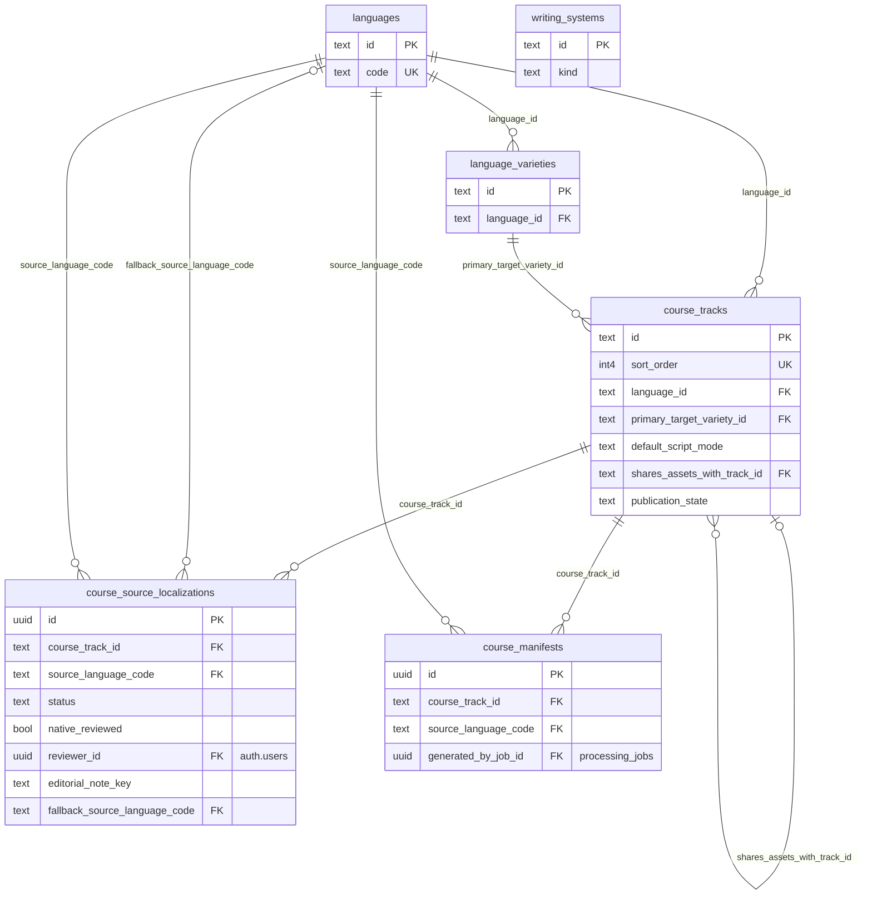
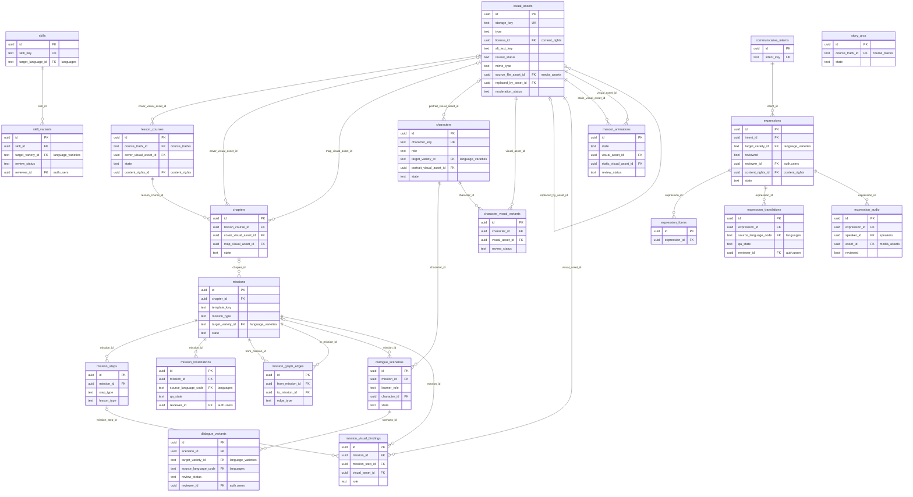
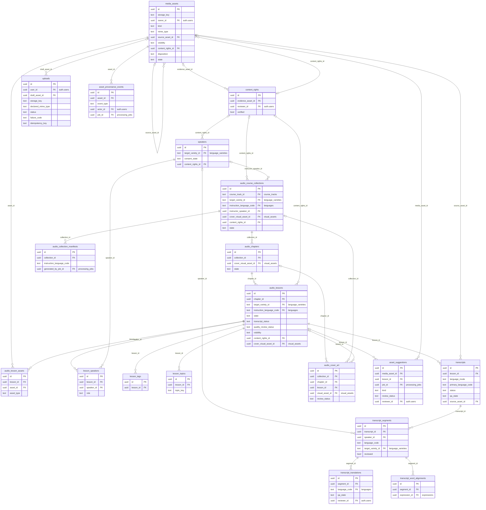
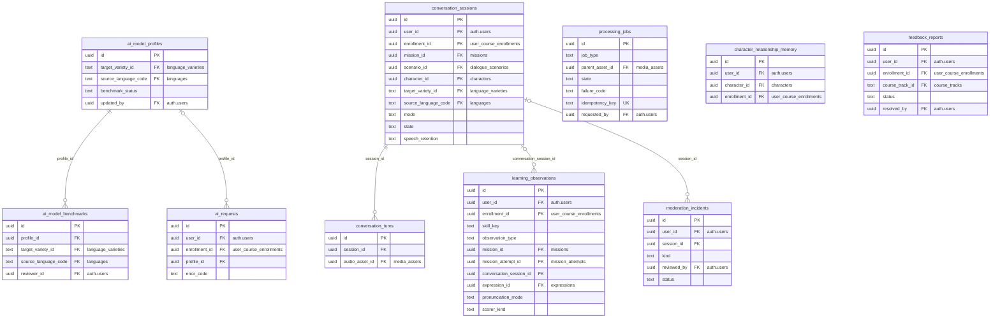
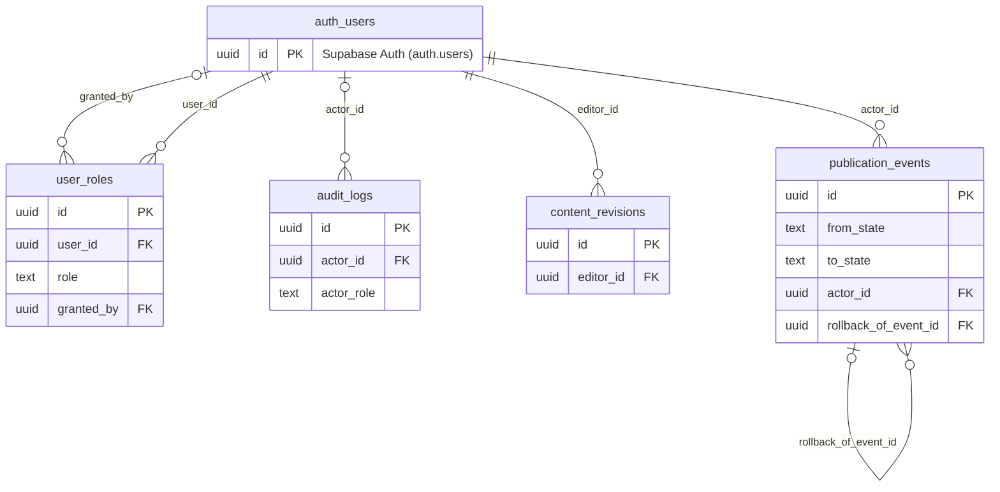

# Database diagram (public schema)

Entity-relationship diagrams of the LangQuest Postgres `public` schema, grouped by domain. Each diagram shows
every table in its domain, its primary key, every foreign key, its single-column unique keys and the columns that
carry state (`state`, `status`, `kind`, `role`, `*_code`, `*_mode`, `visibility`, `disposition` and similar). The full
column lists are in the migrations and in `packages/db/src/database.types.ts` (generated).

**Source.** The migrations `supabase/migrations/20261014100000_000_extensions.sql` through
`20261019180000_140_seed_cast_v2.sql` (15 files). The tables, foreign keys, unique constraints, RLS flags, policies
and functions were confirmed on 2026-10-20 with read-only catalog queries (`begin read only; … rollback;`) against
the local stack at `127.0.0.1:54322`, which was built from those migrations. The 77 tables created by `create table`
in the migrations match the 77 base tables in the database exactly.

**Reading the diagrams.**

- `||--o{` means a required parent. `|o--o{` means a nullable foreign key (optional parent). `--o|` means the child
  column is itself unique (one to at most one).
- The edge label is the foreign-key column.
- A quoted comment such as `"course_tracks"` on an FK column names the referenced table in another domain. Cross-domain
  edges are not drawn, to keep each diagram readable.
- `auth_users` stands for Supabase Auth's `auth.users`. It is drawn only in the learner and admin diagrams. Elsewhere
  the comment `"auth.users"` marks the column.
- Mermaid marks `UK` only on single-column unique keys. Composite unique keys, which carry most idempotency
  guarantees, are listed under each diagram.

Regenerate (manual) after a migration: re-run the read-only catalog queries described in §8 and update the
diagrams. Migrations 080, 130 and 140 are generated seed data and add no tables.

| Domain | Tables | Created in |
|---|---|---|
| 1. Catalog | 6 | `010_identity`, `100_app_gaps` (`course_manifests`) |
| 2. Learners, enrollments, progress | 17 | `010_identity`, `030_audio_library`, `040_ai_tracking` |
| 3. Content, missions, characters | 21 | `020_curriculum`, `050_visual` |
| 4. Media, rights, audio library | 19 | `020_curriculum` (`content_rights`, `media_assets`), `030_audio_library`, `050_visual` (`audio_cover_art`), `100_app_gaps` |
| 5. Jobs, AI, telemetry | 10 | `030_audio_library` (`processing_jobs`), `040_ai_tracking` |
| 6. Admin and roles | 4 | `010_identity` (`user_roles`), `020_curriculum`, `040_ai_tracking` (`audit_logs`) |

## 1. Catalog

Languages, writing systems, varieties and the 30 course tracks (CONVENTIONS §2.1), plus the honest per
(track, instruction language) coverage rows and the published course manifests.



Composite unique keys:

| Table | Unique on |
|---|---|
| `course_source_localizations` | (course_track_id, source_language_code) |
| `course_manifests` | (course_track_id, source_language_code, version) |

## 2. Learners, enrollments, progress

Profiles and settings, one enrollment per (learner, track) with its own `source_language_code`, and the progress
state scoped to that enrollment: mastery, reviews, mission attempts and progress, XP, streaks, metrics, offline sync,
audio progress and downloads.

```mermaid
erDiagram
  auth_users ||--o| profiles : user_id
  auth_users ||--o| account_settings : user_id
  auth_users ||--o{ notification_settings : user_id
  auth_users ||--o{ notification_deliveries : user_id
  auth_users ||--o{ user_course_enrollments : user_id
  user_course_enrollments ||--o{ user_skill_mastery : enrollment_id
  auth_users ||--o{ user_skill_mastery : user_id
  user_course_enrollments ||--o{ user_expression_reviews : enrollment_id
  auth_users ||--o{ user_expression_reviews : user_id
  user_course_enrollments ||--o{ mission_attempts : enrollment_id
  auth_users ||--o{ mission_attempts : user_id
  mission_attempts |o--o{ mission_progress : best_attempt_id
  user_course_enrollments ||--o{ mission_progress : enrollment_id
  auth_users ||--o{ mission_progress : user_id
  user_course_enrollments |o--o{ xp_ledger : enrollment_id
  auth_users ||--o{ xp_ledger : user_id
  user_course_enrollments |o--o{ user_achievements : enrollment_id
  auth_users ||--o{ user_achievements : user_id
  auth_users ||--o{ streak_activity : user_id
  user_course_enrollments ||--o{ daily_learning_metrics : enrollment_id
  auth_users ||--o{ daily_learning_metrics : user_id
  auth_users ||--o{ device_sync_events : user_id
  auth_users ||--o{ user_audio_progress : user_id
  auth_users ||--o{ bookmarks : user_id
  auth_users ||--o{ user_download_manifests : user_id
  auth_users {
    uuid id PK "Supabase Auth (auth.users)"
  }
  profiles {
    uuid user_id PK, FK
    text default_source_language_code FK "languages"
  }
  account_settings {
    uuid user_id PK, FK
    text conversation_mode
  }
  notification_settings {
    uuid id PK
    uuid user_id FK
  }
  notification_deliveries {
    uuid id PK
    uuid user_id FK
    text template_key
    text status
  }
  user_course_enrollments {
    uuid id PK
    uuid user_id FK
    text course_track_id FK "course_tracks"
    text source_language_code FK "languages"
    text preferred_target_variant_id FK "language_varieties"
    text script_mode
    text status
    uuid active_mission_id FK "missions"
    text translation_peek_language_code FK "languages"
  }
  user_skill_mastery {
    uuid id PK
    uuid user_id FK
    uuid enrollment_id FK
    text skill_key
    text mastery_state
  }
  user_expression_reviews {
    uuid id PK
    uuid user_id FK
    uuid enrollment_id FK
    uuid expression_id FK "expressions"
    text skill_key
    text card_state
  }
  mission_attempts {
    uuid id PK
    uuid user_id FK
    uuid enrollment_id FK
    uuid mission_id FK "missions"
  }
  mission_progress {
    uuid id PK
    uuid user_id FK
    uuid enrollment_id FK
    uuid mission_id FK "missions"
    text status
    uuid best_attempt_id FK
  }
  xp_ledger {
    uuid id PK
    uuid user_id FK
    uuid enrollment_id FK
    uuid idempotency_key UK
  }
  user_achievements {
    uuid id PK
    uuid user_id FK
    uuid enrollment_id FK
    text achievement_key
  }
  streak_activity {
    uuid id PK
    uuid user_id FK
  }
  daily_learning_metrics {
    uuid id PK
    uuid user_id FK
    uuid enrollment_id FK
  }
  device_sync_events {
    uuid id PK
    uuid user_id FK
    text payload_type
  }
  user_audio_progress {
    uuid id PK
    uuid user_id FK
    uuid lesson_id FK "audio_lessons"
  }
  bookmarks {
    uuid id PK
    uuid user_id FK
    uuid lesson_id FK "audio_lessons"
    uuid segment_id FK "transcript_segments"
  }
  user_download_manifests {
    uuid id PK
    uuid user_id FK
    uuid lesson_id FK "audio_lessons"
  }
```



Composite unique keys (idempotency keys from offline clients are `client_event_id` / `client_attempt_id`):

| Table | Unique on |
|---|---|
| `notification_settings` | (user_id, channel, platform) |
| `user_course_enrollments` | (user_id, course_track_id, source_language_code) |
| `user_course_enrollments` | (user_id, course_track_id) (partial index) |
| `user_skill_mastery` | (enrollment_id, skill_key) |
| `user_expression_reviews` | (enrollment_id, expression_id) (partial index) |
| `user_expression_reviews` | (enrollment_id, skill_key) (partial index) |
| `mission_attempts` | (user_id, client_attempt_id) |
| `mission_progress` | (enrollment_id, mission_id) |
| `xp_ledger` | (user_id, reason, reference_id) (partial index) |
| `user_achievements` | (user_id, client_event_id) |
| `user_achievements` | (user_id, achievement_key) |
| `streak_activity` | (user_id, activity_date) |
| `daily_learning_metrics` | (enrollment_id, metric_date) |
| `device_sync_events` | (user_id, client_event_id) |
| `user_audio_progress` | (user_id, lesson_id) |
| `bookmarks` | (user_id, client_event_id) |
| `user_download_manifests` | (user_id, lesson_id, pack_id) |

## 3. Content, missions, characters

Curriculum: lesson courses, chapters, story arcs, missions and their steps and localizations, the mission graph,
skills and intents, expressions with forms, translations and audio, dialogue scenarios and variants, the cast and its
visual variants, and visual assets with their bindings.



Composite unique keys:

| Table | Unique on |
|---|---|
| `missions` | (template_key) (partial index) |
| `mission_steps` | (mission_id, sort_order) |
| `mission_localizations` | (mission_id, source_language_code) |
| `mission_graph_edges` | (from_mission_id, to_mission_id, edge_type) |
| `skill_variants` | (skill_id, target_variety_id) |
| `expression_translations` | (expression_id, source_language_code) |

## 4. Media, rights, audio library

`content_rights` is one row per rights grant. Media assets, lessons, speakers and expressions point at it through
`content_rights_id`, and `revoke_content_rights` unpublishes the dependents in one transaction. Also in this domain:
uploads, speakers, the audio library (collections, chapters, lessons, lesson assets, speakers, tags and topics),
transcripts with segments, translations and word alignments, provenance events, cover art, collection manifests and
AI organisation suggestions.



Composite unique keys:

| Table | Unique on |
|---|---|
| `uploads` | (user_id, idempotency_key) |
| `audio_lesson_assets` | (lesson_id, asset_id, asset_type) |
| `lesson_speakers` | (lesson_id, speaker_id, role) |
| `lesson_tags` | (lesson_id, tag) |
| `lesson_topics` | (lesson_id, topic_key) |
| `transcripts` | (lesson_id, revision) |
| `transcript_segments` | (transcript_id, sort_index) |
| `transcript_translations` | (segment_id, language_code) |
| `transcript_word_alignments` | (segment_id, word_index) |
| `audio_collection_manifests` | (collection_id, instruction_language_code, version) |

## 5. Jobs, AI, telemetry

The Postgres job queue, AI model routing and benchmarks, the AI request ledger (cost accounting), conversation
sessions and turns, evaluator observations, per-character relationship memory, moderation incidents and feedback
reports.



Composite unique keys:

| Table | Unique on |
|---|---|
| `ai_model_profiles` | (task, target_variety_id, source_language_code) |
| `conversation_turns` | (session_id, turn_index) |
| `conversation_turns` | (session_id, client_turn_id) (partial index) |
| `character_relationship_memory` | (user_id, character_id, enrollment_id) |

## 6. Admin and roles

Staff roles (`super_admin`, `admin`, `content_editor`, `language_reviewer`, `support_readonly`; a learner has none),
the audit log, and the append-only editorial ledgers.



Composite unique keys:

| Table | Unique on |
|---|---|
| `user_roles` | (user_id, role) |
| `content_revisions` | (entity_table, entity_id, revision) |

## 7. Row-level security and SECURITY DEFINER functions

### RLS

- **RLS is on for every public table.** Migration `070_rls.sql` §1 enables it in a loop over `pg_tables`, and §9 raises
  an exception if any public table lacks it. Verified on the local stack: 77 of 77 tables have `relrowsecurity = true`,
  and 282 policies exist in `public`. The service role bypasses RLS as usual.
- **User-owned tables** (owner = `user_id = auth.uid()`; `070_rls.sql` §2):
  - Full CRUD: `user_course_enrollments`, `bookmarks`, `user_audio_progress`, `user_download_manifests`,
    `character_relationship_memory`, `user_expression_reviews`, `notification_settings`, `conversation_sessions`.
  - Select, insert and update only: `profiles`, `account_settings`.
  - Owner read-only, written by the service role: `user_roles`, `xp_ledger`, `device_sync_events`,
    `learning_observations`, `user_achievements`, `notification_deliveries`, `user_skill_mastery`, `mission_progress`,
    `streak_activity`, `daily_learning_metrics`.
  - `mission_attempts`: learners insert and update their own rows, but the outcome columns are server-decided
    (trigger `guard_mission_attempt_write`) and there is no learner delete.
  - `support_readonly` staff can select the learner tables listed in `support_readable` through `is_support()`.
- **Catalog** (§3): readable by everyone. **Curriculum content** (§4): learners see published rows, staff see drafts,
  and editors and reviewers write. **Audio library** (§5): published rows, authenticated readers only (no anonymous
  playback). **AI routing, requests, moderation, audit** (§6): `processing_jobs` is staff-read only, `ai_requests` and
  `audit_logs` are admin-read only. **Visual assets** (§7): approved art is public, drafts are staff only.
- **Column exposure** (§8): for `anon` and `authenticated`, column-level grants replace the table-level SELECT on
  `course_source_localizations` (which hides `reviewer_id`) and `media_assets` (which hides `owner_id`,
  `legacy_filename` and `legacy_path`). Staff and the service role read full rows through the `security_barrier`
  views `course_source_localizations_staff` and `media_assets_staff`, which return no rows for anyone else.
- **Append-only ledgers** (trigger `raise_append_only`): `content_revisions`, `publication_events`,
  `asset_provenance_events`, `ai_requests`, `conversation_turns`, `learning_observations`, `xp_ledger`,
  `notification_deliveries`, `audit_logs`. On `device_sync_events`, `guard_sync_event_update` allows only the
  applied marker.
- Other guard triggers: `guard_profile_update` (`profiles`), `guard_enrollment_identity` and
  `resolve_enrollment_script_mode` (`user_course_enrollments`), `guard_upload_client_write` and `guard_upload_row`
  (`uploads`), `set_conversation_turn_retention` (`conversation_turns`), `stamp_asset_suggestion_decision`
  (`asset_suggestions`).
- Negative RLS tests: the pgTAP files `supabase/tests/database/*.test.sql` and the `tests/` security suites
  (`docs/runbooks/database.md`).

### SECURITY DEFINER functions

All 24 of them pin `search_path = public` (verified via `pg_proc.proconfig`). "Who can execute" is the
`has_function_privilege` result on the local stack.

| Function | Defined in | Who can execute | Guard inside the function |
|---|---|---|---|
| `has_role(text)`, `has_any_role(text[])`, `is_staff()`, `is_admin()`, `is_content_editor()`, `is_language_reviewer()`, `is_support()` | `010_identity` | anon, authenticated, service_role | Read `user_roles` for `auth.uid()`; used by the policies |
| `handle_new_user()` | `010_identity` | trigger on `auth.users` | Creates the profile row on sign-up |
| `enqueue_processing_job(...)` | `060_functions` | authenticated, service_role | A JWT caller must be a content editor; `requested_by` is forced to `auth.uid()` |
| `claim_processing_job`, `heartbeat_processing_job`, `complete_processing_job`, `fail_processing_job`, `requeue_expired_jobs` | `060_functions` | service_role | Job-runner lease protocol (`apps/jobs`) |
| `award_xp(...)`, `xp_reference_owned(...)` | `060_functions` | service_role | `on conflict (idempotency_key) do nothing`; a JWT caller other than the user must be an admin |
| `apply_sync_events(...)`, `mark_sync_events_applied(...)` | `060_functions` (`apply_sync_events` redefined in `110_audio_progress_resolution`) | authenticated, service_role | The user is `coalesce(auth.uid(), p_user_id)`; a JWT caller cannot act for another user |
| `set_enrollment_source_language(uuid, text)` | `060_functions` | authenticated, service_role | The enrollment must belong to `auth.uid()`; mastery and progress are kept |
| `owns_media_asset(uuid)` | `070_rls` | authenticated, service_role | `media_assets.owner_id = auth.uid()` (policy helper) |
| `set_conversation_turn_retention()` | `070_rls` | trigger | Sets each turn's `expires_at` from the session's `speech_retention` (24 hours by default, 30 days or kept when the learner opts in) |
| `delete_account(uuid, boolean)` | `100_app_gaps` | service_role only | Account deletion (§11, A28): deletes or anonymises in one transaction |
| `purge_test_user(uuid)` | `100_app_gaps` | service_role only | Refuses any JWT caller; purges `@langquest.test` accounts only |
| `revoke_content_rights(uuid, text, text, uuid)` | `120_admin_structure` | authenticated, service_role | An authenticated caller must be a content editor; unpublishes dependents and revokes offline packs |

The non-definer helpers `apply_audio_progress` (`110`, execute revoked from every role, called inside
`apply_sync_events`), `reorder_audio_chapters` and `reorder_audio_lessons` (`120`), `get_due_reviews`,
`user_total_xp` and `xp_amount_for_reason` run with the caller's rights, so RLS applies to them.

## 8. Re-deriving this document

Run these read-only queries against the local stack (never during another session's write-heavy tests). Each
`psql` call wraps its statement in `begin read only; … rollback;`.

```sh
export PGPASSWORD=postgres   # local Supabase default; never a hosted credential
Q() { psql -h 127.0.0.1 -p 54322 -U postgres -d postgres -At -F '|' -c 'begin read only;' -c "$1" -c 'rollback;'; }
# tables + RLS flag + policy count
Q "select c.relname, c.relrowsecurity, (select count(*) from pg_policy p where p.polrelid = c.oid) from pg_class c join pg_namespace n on n.oid = c.relnamespace where n.nspname = 'public' and c.relkind = 'r' order by 1"
# foreign keys (incl. auth.users)
Q "select c.conrelid::regclass, a.attname, c.confrelid::regclass, af.attname from pg_constraint c join pg_namespace n on n.oid = c.connamespace and n.nspname = 'public' cross join lateral unnest(c.conkey, c.confkey) k(s, d) join pg_attribute a on a.attrelid = c.conrelid and a.attnum = k.s join pg_attribute af on af.attrelid = c.confrelid and af.attnum = k.d where c.contype = 'f' order by 1, 2"
# SECURITY DEFINER functions
Q "select p.proname, p.prosecdef, p.proconfig from pg_proc p join pg_namespace n on n.oid = p.pronamespace where n.nspname = 'public' and p.prokind = 'f' order by 2 desc, 1"
```
